# Statistics report (primary machine)

> Time and comparisons are divided by text length n before testing because exact lengths vary up to tenfold within each level and are drawn independently for each condition. This normalization was adopted after inspecting the first, unnormalized analysis, which is reported in the appendix.

Generated 2026-11-04 10:40:04 UTC by `analyze.py` from `raw_runs.csv` (5,130 rows).

## Method

- α = 0.05. Every test is run per algorithm and per text-length level.
- Shapiro-Wilk on every group (skipped for a zero-variance group, which then forces the non-parametric test).
- Two groups: Welch's t-test if every group is normal, otherwise Mann-Whitney U (two-sided). Four groups: one-way ANOVA if every group is normal, otherwise Kruskal-Wallis.
- Effect sizes: Cohen's d (pooled SD; small 0.2, medium 0.5, large 0.8; Cohen, 1988), Cliff's δ (< 0.11 negligible, < 0.28 small, < 0.43 medium, else large), η² (small 0.01, medium 0.06, large 0.14; Cohen, 1988) and ε² = H/(N − 1) (small 0.01, medium 0.06, large 0.14). Values below the small threshold are labelled negligible. The sign of d and δ is first group minus second group.
- Holm's correction across all 81 tests as one family. Tests that are not applicable (no variance at all) stay in the family, are ranked last (as if p = 1) and are never rejected.
- Time = total time (prep + search) per call ÷ text length n, in ns per text character; comparisons = (prep + search comparisons) ÷ n, in comparisons per text character; memory = `memory_bytes` in bytes, not normalized (structure only; it does not depend on the text; exact definitions per algorithm in the descriptive section). `memory_retained_raw_bytes` and `memory_peak_bytes` are descriptive only.
- Descriptive-only section: the core-grid time and comparison tables are also per text character (raw-unit versions in the appendix). The σ/(σ − 1) table is per alignment, the positive control uses fixed inputs and shows its own per-character columns, and the memory tables are in bytes.

## Decisions summary

**36 of 81 null hypotheses rejected after Holm's correction.**

| Hypothesis | Tests | Reject | Fail to reject | Not applicable |
| --- | ---: | ---: | ---: | ---: |
| H0-1 | 9 | 3 | 6 | 0 |
| H0-2 | 9 | 7 | 2 | 0 |
| H0-3 | 6 | 0 | 6 | 0 |
| H0-4 | 3 | 3 | 0 | 0 |
| H0-5 | 3 | 3 | 0 | 0 |
| H0-6 | 3 | 3 | 0 | 0 |
| H0-7 | 9 | 0 | 9 | 0 |
| H0-8 | 9 | 0 | 9 | 0 |
| H0-9 | 6 | 0 | 6 | 0 |
| H0-10 | 9 | 8 | 1 | 0 |
| H0-11 | 9 | 9 | 0 | 0 |
| H0-12 | 6 | 0 | 6 | 0 |
| **Total** | 81 | 36 | 45 | 0 |

| # | Hypothesis | Algorithm | Text length | Test | Holm-adjusted p | Decision |
| ---: | --- | --- | --- | --- | ---: | --- |
| 1 | H0-1 | Naive | 10–100 | Mann-Whitney U | 1.0000 | Fail to reject H0 |
| 2 | H0-1 | Naive | 100–1000 | Mann-Whitney U | 1.0000 | Fail to reject H0 |
| 3 | H0-1 | Naive | 1000–10000 | Mann-Whitney U | 9.95e-05 | **Reject H0** |
| 4 | H0-1 | KMP | 10–100 | Mann-Whitney U | 1.0000 | Fail to reject H0 |
| 5 | H0-1 | KMP | 100–1000 | Mann-Whitney U | 0.0114 | **Reject H0** |
| 6 | H0-1 | KMP | 1000–10000 | Mann-Whitney U | 5.40e-07 | **Reject H0** |
| 7 | H0-1 | Aho-Corasick | 10–100 | Mann-Whitney U | 1.0000 | Fail to reject H0 |
| 8 | H0-1 | Aho-Corasick | 100–1000 | Mann-Whitney U | 1.0000 | Fail to reject H0 |
| 9 | H0-1 | Aho-Corasick | 1000–10000 | Mann-Whitney U | 0.2867 | Fail to reject H0 |
| 10 | H0-2 | Naive | 10–100 | Mann-Whitney U | 4.49e-07 | **Reject H0** |
| 11 | H0-2 | Naive | 100–1000 | Mann-Whitney U | 1.60e-10 | **Reject H0** |
| 12 | H0-2 | Naive | 1000–10000 | Mann-Whitney U | 1.31e-10 | **Reject H0** |
| 13 | H0-2 | KMP | 10–100 | Mann-Whitney U | 1.0000 | Fail to reject H0 |
| 14 | H0-2 | KMP | 100–1000 | Mann-Whitney U | 1.35e-06 | **Reject H0** |
| 15 | H0-2 | KMP | 1000–10000 | Mann-Whitney U | 1.19e-09 | **Reject H0** |
| 16 | H0-2 | Aho-Corasick | 10–100 | Mann-Whitney U | 1.0000 | Fail to reject H0 |
| 17 | H0-2 | Aho-Corasick | 100–1000 | Mann-Whitney U | 1.19e-09 | **Reject H0** |
| 18 | H0-2 | Aho-Corasick | 1000–10000 | Mann-Whitney U | 1.51e-21 | **Reject H0** |
| 19 | H0-3 | KMP | 10–100 | Mann-Whitney U | 1.0000 | Fail to reject H0 |
| 20 | H0-3 | KMP | 100–1000 | Mann-Whitney U | 1.0000 | Fail to reject H0 |
| 21 | H0-3 | KMP | 1000–10000 | Mann-Whitney U | 1.0000 | Fail to reject H0 |
| 22 | H0-3 | Aho-Corasick | 10–100 | Mann-Whitney U | 1.0000 | Fail to reject H0 |
| 23 | H0-3 | Aho-Corasick | 100–1000 | Mann-Whitney U | 1.0000 | Fail to reject H0 |
| 24 | H0-3 | Aho-Corasick | 1000–10000 | Mann-Whitney U | 1.0000 | Fail to reject H0 |
| 25 | H0-4 | Aho-Corasick | 10–100 | Mann-Whitney U | 3.19e-40 | **Reject H0** |
| 26 | H0-4 | Aho-Corasick | 100–1000 | Mann-Whitney U | 1.35e-55 | **Reject H0** |
| 27 | H0-4 | Aho-Corasick | 1000–10000 | Mann-Whitney U | 1.32e-58 | **Reject H0** |
| 28 | H0-5 | Aho-Corasick | 10–100 | Mann-Whitney U | 1.37e-41 | **Reject H0** |
| 29 | H0-5 | Aho-Corasick | 100–1000 | Mann-Whitney U | 1.01e-43 | **Reject H0** |
| 30 | H0-5 | Aho-Corasick | 1000–10000 | Mann-Whitney U | 6.03e-39 | **Reject H0** |
| 31 | H0-6 | Aho-Corasick | 10–100 | Mann-Whitney U | 1.95e-40 | **Reject H0** |
| 32 | H0-6 | Aho-Corasick | 100–1000 | Mann-Whitney U | 1.44e-43 | **Reject H0** |
| 33 | H0-6 | Aho-Corasick | 1000–10000 | Mann-Whitney U | 4.51e-43 | **Reject H0** |
| 34 | H0-7 | Naive | 10–100 | Mann-Whitney U | 1.0000 | Fail to reject H0 |
| 35 | H0-7 | Naive | 100–1000 | Mann-Whitney U | 1.0000 | Fail to reject H0 |
| 36 | H0-7 | Naive | 1000–10000 | Mann-Whitney U | 1.0000 | Fail to reject H0 |
| 37 | H0-7 | KMP | 10–100 | Mann-Whitney U | 1.0000 | Fail to reject H0 |
| 38 | H0-7 | KMP | 100–1000 | Welch's t-test | 0.6503 | Fail to reject H0 |
| 39 | H0-7 | KMP | 1000–10000 | Mann-Whitney U | 1.0000 | Fail to reject H0 |
| 40 | H0-7 | Aho-Corasick | 10–100 | Mann-Whitney U | 1.0000 | Fail to reject H0 |
| 41 | H0-7 | Aho-Corasick | 100–1000 | Mann-Whitney U | 1.0000 | Fail to reject H0 |
| 42 | H0-7 | Aho-Corasick | 1000–10000 | Welch's t-test | 1.0000 | Fail to reject H0 |
| 43 | H0-8 | Naive | 10–100 | Mann-Whitney U | 1.0000 | Fail to reject H0 |
| 44 | H0-8 | Naive | 100–1000 | Mann-Whitney U | 1.0000 | Fail to reject H0 |
| 45 | H0-8 | Naive | 1000–10000 | Mann-Whitney U | 1.0000 | Fail to reject H0 |
| 46 | H0-8 | KMP | 10–100 | Mann-Whitney U | 1.0000 | Fail to reject H0 |
| 47 | H0-8 | KMP | 100–1000 | Mann-Whitney U | 0.1815 | Fail to reject H0 |
| 48 | H0-8 | KMP | 1000–10000 | Mann-Whitney U | 1.0000 | Fail to reject H0 |
| 49 | H0-8 | Aho-Corasick | 10–100 | Mann-Whitney U | 1.0000 | Fail to reject H0 |
| 50 | H0-8 | Aho-Corasick | 100–1000 | Mann-Whitney U | 0.6677 | Fail to reject H0 |
| 51 | H0-8 | Aho-Corasick | 1000–10000 | Mann-Whitney U | 1.0000 | Fail to reject H0 |
| 52 | H0-9 | KMP | 10–100 | Mann-Whitney U | 1.0000 | Fail to reject H0 |
| 53 | H0-9 | KMP | 100–1000 | Mann-Whitney U | 1.0000 | Fail to reject H0 |
| 54 | H0-9 | KMP | 1000–10000 | Mann-Whitney U | 1.0000 | Fail to reject H0 |
| 55 | H0-9 | Aho-Corasick | 10–100 | Mann-Whitney U | 1.0000 | Fail to reject H0 |
| 56 | H0-9 | Aho-Corasick | 100–1000 | Mann-Whitney U | 1.0000 | Fail to reject H0 |
| 57 | H0-9 | Aho-Corasick | 1000–10000 | Mann-Whitney U | 1.0000 | Fail to reject H0 |
| 58 | H0-10 | Naive | 10–100 | Kruskal-Wallis | 1.24e-19 | **Reject H0** |
| 59 | H0-10 | Naive | 100–1000 | Kruskal-Wallis | 4.63e-20 | **Reject H0** |
| 60 | H0-10 | Naive | 1000–10000 | Kruskal-Wallis | 4.07e-20 | **Reject H0** |
| 61 | H0-10 | KMP | 10–100 | Kruskal-Wallis | 4.58e-12 | **Reject H0** |
| 62 | H0-10 | KMP | 100–1000 | Kruskal-Wallis | 6.10e-20 | **Reject H0** |
| 63 | H0-10 | KMP | 1000–10000 | Kruskal-Wallis | 2.87e-20 | **Reject H0** |
| 64 | H0-10 | Aho-Corasick | 10–100 | Kruskal-Wallis | 0.2471 | Fail to reject H0 |
| 65 | H0-10 | Aho-Corasick | 100–1000 | Kruskal-Wallis | 3.93e-17 | **Reject H0** |
| 66 | H0-10 | Aho-Corasick | 1000–10000 | Kruskal-Wallis | 3.13e-21 | **Reject H0** |
| 67 | H0-11 | Naive | 10–100 | Kruskal-Wallis | 1.84e-18 | **Reject H0** |
| 68 | H0-11 | Naive | 100–1000 | One-way ANOVA | 2.90e-125 | **Reject H0** |
| 69 | H0-11 | Naive | 1000–10000 | One-way ANOVA | 1.85e-159 | **Reject H0** |
| 70 | H0-11 | KMP | 10–100 | Kruskal-Wallis | 1.77e-16 | **Reject H0** |
| 71 | H0-11 | KMP | 100–1000 | Kruskal-Wallis | 1.37e-21 | **Reject H0** |
| 72 | H0-11 | KMP | 1000–10000 | Kruskal-Wallis | 3.53e-22 | **Reject H0** |
| 73 | H0-11 | Aho-Corasick | 10–100 | Kruskal-Wallis | 9.14e-10 | **Reject H0** |
| 74 | H0-11 | Aho-Corasick | 100–1000 | Kruskal-Wallis | 5.78e-21 | **Reject H0** |
| 75 | H0-11 | Aho-Corasick | 1000–10000 | Kruskal-Wallis | 3.53e-22 | **Reject H0** |
| 76 | H0-12 | KMP | 10–100 | Kruskal-Wallis | 1.0000 | Fail to reject H0 |
| 77 | H0-12 | KMP | 100–1000 | Kruskal-Wallis | 1.0000 | Fail to reject H0 |
| 78 | H0-12 | KMP | 1000–10000 | Kruskal-Wallis | 1.0000 | Fail to reject H0 |
| 79 | H0-12 | Aho-Corasick | 10–100 | Kruskal-Wallis | 1.0000 | Fail to reject H0 |
| 80 | H0-12 | Aho-Corasick | 100–1000 | Kruskal-Wallis | 1.0000 | Fail to reject H0 |
| 81 | H0-12 | Aho-Corasick | 1000–10000 | Kruskal-Wallis | 1.0000 | Fail to reject H0 |

## H0-1: There is no significant difference in completion time between random text and narrative text, for each algorithm.

H0-1: There is no significant difference in completion time between random text and narrative text, for each algorithm.

*Experiment: `core` (pooled over the 3 query lengths and both query counts). Dependent variable: total time ÷ text length (ns per text character). Algorithms tested: Naive, KMP, Aho-Corasick.*

| Algorithm | Text length | Group stats (mean ± SD, median) | Normality result | Test used | Statistic | Raw p | Holm-adjusted p | Decision | Effect size (label) |
| --- | --- | --- | --- | --- | --- | ---: | ---: | --- | --- |
| Naive | 10–100 | Random: 131.66 ± 86.99 (Mdn 130.85, n = 180) Narrative: 133.76 ± 88.57 (Mdn 131.60, n = 180) | Random: W = 0.716, p = 2.94e-17 ✗ not normal Narrative: W = 0.718, p = 3.57e-17 ✗ not normal | Mann-Whitney U | U = 15,003.0 | 0.2255 | 1.0000 | Fail to reject H0 | δ = -0.074 (negligible); Narrative > Random |
| Naive | 100–1000 | Random: 135.99 ± 91.79 (Mdn 126.39, n = 180) Narrative: 139.74 ± 94.16 (Mdn 127.34, n = 180) | Random: W = 0.703, p = 1.27e-17 ✗ not normal Narrative: W = 0.722, p = 4.61e-17 ✗ not normal | Mann-Whitney U | U = 14,177.0 | 0.0405 | 1.0000 | Fail to reject H0 | δ = -0.125 (small); Narrative > Random |
| Naive | 1000–10000 | Random: 148.69 ± 99.75 (Mdn 145.51, n = 180) Narrative: 154.62 ± 103.60 (Mdn 149.17, n = 180) | Random: W = 0.661, p = 9.19e-19 ✗ not normal Narrative: W = 0.684, p = 3.58e-18 ✗ not normal | Mann-Whitney U | U = 11,518.0 | 2.12e-06 | 9.95e-05 | **Reject H0** | δ = -0.289 (medium); Narrative > Random |
| KMP | 10–100 | Random: 143.42 ± 96.03 (Mdn 139.41, n = 180) Narrative: 150.43 ± 105.19 (Mdn 143.62, n = 180) | Random: W = 0.823, p = 1.69e-13 ✗ not normal Narrative: W = 0.839, p = 7.73e-13 ✗ not normal | Mann-Whitney U | U = 15,453.0 | 0.4496 | 1.0000 | Fail to reject H0 | δ = -0.046 (negligible); Narrative > Random |
| KMP | 100–1000 | Random: 116.70 ± 78.41 (Mdn 113.17, n = 180) Narrative: 121.24 ± 81.03 (Mdn 113.51, n = 180) | Random: W = 0.685, p = 4.03e-18 ✗ not normal Narrative: W = 0.700, p = 1.05e-17 ✗ not normal | Mann-Whitney U | U = 12,581.0 | 0.0002 | 0.0114 | **Reject H0** | δ = -0.223 (small); Narrative > Random |
| KMP | 1000–10000 | Random: 118.01 ± 79.23 (Mdn 118.23, n = 180) Narrative: 124.59 ± 83.47 (Mdn 121.47, n = 180) | Random: W = 0.660, p = 8.37e-19 ✗ not normal Narrative: W = 0.687, p = 4.57e-18 ✗ not normal | Mann-Whitney U | U = 10,558.0 | 1.10e-08 | 5.40e-07 | **Reject H0** | δ = -0.348 (medium); Narrative > Random |
| Aho-Corasick | 10–100 | Random: 176.12 ± 117.67 (Mdn 147.12, n = 180) Narrative: 186.68 ± 145.86 (Mdn 125.53, n = 180) | Random: W = 0.805, p = 3.15e-14 ✗ not normal Narrative: W = 0.761, p = 8.06e-16 ✗ not normal | Mann-Whitney U | U = 16,469.0 | 0.7857 | 1.0000 | Fail to reject H0 | δ = +0.017 (negligible); Random > Narrative |
| Aho-Corasick | 100–1000 | Random: 72.48 ± 22.97 (Mdn 68.62, n = 180) Narrative: 74.86 ± 22.09 (Mdn 71.37, n = 180) | Random: W = 0.707, p = 1.70e-17 ✗ not normal Narrative: W = 0.802, p = 2.29e-14 ✗ not normal | Mann-Whitney U | U = 14,409.0 | 0.0697 | 1.0000 | Fail to reject H0 | δ = -0.111 (small); Narrative > Random |
| Aho-Corasick | 1000–10000 | Random: 61.49 ± 6.61 (Mdn 60.45, n = 180) Narrative: 63.84 ± 9.08 (Mdn 62.20, n = 180) | Random: W = 0.786, p = 5.72e-15 ✗ not normal Narrative: W = 0.919, p = 1.90e-08 ✗ not normal | Mann-Whitney U | U = 13,521.0 | 0.0067 | 0.2867 | Fail to reject H0 | δ = -0.165 (small); Narrative > Random |

*Group stats in ns per text character. See Figure 5.2a.*

## H0-2: There is no significant difference in character comparisons between random text and narrative text, for each algorithm.

H0-2: There is no significant difference in character comparisons between random text and narrative text, for each algorithm.

*Experiment: `core` (pooled over the 3 query lengths and both query counts). Dependent variable: comparisons (prep + search) ÷ text length (comparisons per text character). Algorithms tested: Naive, KMP, Aho-Corasick.*

| Algorithm | Text length | Group stats (mean ± SD, median) | Normality result | Test used | Statistic | Raw p | Holm-adjusted p | Decision | Effect size (label) |
| --- | --- | --- | --- | --- | --- | ---: | ---: | --- | --- |
| Naive | 10–100 | Random: 3.035 ± 2.031 (Mdn 3.032, n = 180) Narrative: 3.173 ± 2.128 (Mdn 3.129, n = 180) | Random: W = 0.649, p = 4.31e-19 ✗ not normal Narrative: W = 0.681, p = 3.02e-18 ✗ not normal | Mann-Whitney U | U = 10,553.0 | 8.99e-09 | 4.49e-07 | **Reject H0** | δ = -0.349 (medium); Narrative > Random |
| Naive | 100–1000 | Random: 3.037 ± 2.030 (Mdn 3.029, n = 180) Narrative: 3.220 ± 2.152 (Mdn 3.145, n = 180) | Random: W = 0.641, p = 2.76e-19 ✗ not normal Narrative: W = 0.678, p = 2.59e-18 ✗ not normal | Mann-Whitney U | U = 9,309.0 | 2.96e-12 | 1.60e-10 | **Reject H0** | δ = -0.425 (medium); Narrative > Random |
| Naive | 1000–10000 | Random: 3.038 ± 2.031 (Mdn 3.023, n = 180) Narrative: 3.228 ± 2.157 (Mdn 3.164, n = 180) | Random: W = 0.639, p = 2.46e-19 ✗ not normal Narrative: W = 0.680, p = 2.93e-18 ✗ not normal | Mann-Whitney U | U = 9,279.0 | 2.38e-12 | 1.31e-10 | **Reject H0** | δ = -0.427 (medium); Narrative > Random |
| KMP | 10–100 | Random: 3.501 ± 2.354 (Mdn 3.425, n = 180) Narrative: 3.715 ± 2.567 (Mdn 3.561, n = 180) | Random: W = 0.770, p = 1.56e-15 ✗ not normal Narrative: W = 0.797, p = 1.54e-14 ✗ not normal | Mann-Whitney U | U = 14,415.0 | 0.0707 | 1.0000 | Fail to reject H0 | δ = -0.110 (small); Narrative > Random |
| KMP | 100–1000 | Random: 3.093 ± 2.069 (Mdn 3.093, n = 180) Narrative: 3.243 ± 2.165 (Mdn 3.180, n = 180) | Random: W = 0.664, p = 1.10e-18 ✗ not normal Narrative: W = 0.685, p = 4.02e-18 ✗ not normal | Mann-Whitney U | U = 10,717.0 | 2.80e-08 | 1.35e-06 | **Reject H0** | δ = -0.338 (medium); Narrative > Random |
| KMP | 1000–10000 | Random: 3.043 ± 2.034 (Mdn 3.027, n = 180) Narrative: 3.199 ± 2.137 (Mdn 3.123, n = 180) | Random: W = 0.640, p = 2.65e-19 ✗ not normal Narrative: W = 0.677, p = 2.39e-18 ✗ not normal | Mann-Whitney U | U = 9,598.0 | 2.28e-11 | 1.19e-09 | **Reject H0** | δ = -0.408 (medium); Narrative > Random |
| Aho-Corasick | 10–100 | Random: 2.083 ± 1.111 (Mdn 1.750, n = 180) Narrative: 2.356 ± 1.507 (Mdn 1.708, n = 180) | Random: W = 0.797, p = 1.54e-14 ✗ not normal Narrative: W = 0.758, p = 6.43e-16 ✗ not normal | Mann-Whitney U | U = 14,962.0 | 0.2100 | 1.0000 | Fail to reject H0 | δ = -0.076 (negligible); Narrative > Random |
| Aho-Corasick | 100–1000 | Random: 1.167 ± 0.204 (Mdn 1.108, n = 180) Narrative: 1.310 ± 0.268 (Mdn 1.242, n = 180) | Random: W = 0.652, p = 5.11e-19 ✗ not normal Narrative: W = 0.841, p = 9.59e-13 ✗ not normal | Mann-Whitney U | U = 9,600.0 | 2.32e-11 | 1.19e-09 | **Reject H0** | δ = -0.407 (medium); Narrative > Random |
| Aho-Corasick | 1000–10000 | Random: 1.051 ± 0.036 (Mdn 1.047, n = 180) Narrative: 1.192 ± 0.137 (Mdn 1.184, n = 180) | Random: W = 0.834, p = 4.87e-13 ✗ not normal Narrative: W = 0.918, p = 1.59e-08 ✗ not normal | Mann-Whitney U | U = 6,365.0 | 2.25e-23 | 1.51e-21 | **Reject H0** | δ = -0.607 (large); Narrative > Random |

*Group stats in comparisons per text character. See Figure 5.2b.*

## H0-3: There is no significant difference in memory use between random text and narrative text, for each algorithm.

H0-3: There is no significant difference in memory use between random text and narrative text, for each algorithm.

*Experiment: `core` (pooled over the 3 query lengths and both query counts). Dependent variable: memory use (structure bytes) (bytes). Algorithms tested: KMP, Aho-Corasick.*

| Algorithm | Text length | Group stats (mean ± SD, median) | Normality result | Test used | Statistic | Raw p | Holm-adjusted p | Decision | Effect size (label) |
| --- | --- | --- | --- | --- | --- | ---: | ---: | --- | --- |
| KMP | 10–100 | Random: 531 ± 300 (Mdn 444, n = 180) Narrative: 532 ± 301 (Mdn 448, n = 180) | Random: W = 0.866, p = 1.52e-11 ✗ not normal Narrative: W = 0.863, p = 1.03e-11 ✗ not normal | Mann-Whitney U | U = 16,109.0 | 0.9269 | 1.0000 | Fail to reject H0 | δ = -0.006 (negligible); Narrative > Random |
| KMP | 100–1000 | Random: 536 ± 309 (Mdn 444, n = 180) Narrative: 530 ± 302 (Mdn 436, n = 180) | Random: W = 0.856, p = 5.03e-12 ✗ not normal Narrative: W = 0.861, p = 8.43e-12 ✗ not normal | Mann-Whitney U | U = 16,422.0 | 0.8224 | 1.0000 | Fail to reject H0 | δ = +0.014 (negligible); Random > Narrative |
| KMP | 1000–10000 | Random: 533 ± 304 (Mdn 448, n = 180) Narrative: 533 ± 307 (Mdn 440, n = 180) | Random: W = 0.865, p = 1.41e-11 ✗ not normal Narrative: W = 0.857, p = 5.66e-12 ✗ not normal | Mann-Whitney U | U = 16,157.5 | 0.9661 | 1.0000 | Fail to reject H0 | δ = -0.003 (negligible); Narrative > Random |
| Aho-Corasick | 10–100 | Random: 6,916 ± 6,153 (Mdn 4,284, n = 180) Narrative: 6,784 ± 5,980 (Mdn 4,036, n = 180) | Random: W = 0.806, p = 3.36e-14 ✗ not normal Narrative: W = 0.807, p = 3.60e-14 ✗ not normal | Mann-Whitney U | U = 16,453.5 | 0.7977 | 1.0000 | Fail to reject H0 | δ = +0.016 (negligible); Random > Narrative |
| Aho-Corasick | 100–1000 | Random: 7,309 ± 6,694 (Mdn 4,192, n = 180) Narrative: 7,078 ± 6,430 (Mdn 4,272, n = 180) | Random: W = 0.789, p = 7.90e-15 ✗ not normal Narrative: W = 0.787, p = 6.69e-15 ✗ not normal | Mann-Whitney U | U = 16,493.0 | 0.7670 | 1.0000 | Fail to reject H0 | δ = +0.018 (negligible); Random > Narrative |
| Aho-Corasick | 1000–10000 | Random: 7,237 ± 6,547 (Mdn 4,192, n = 180) Narrative: 7,168 ± 6,604 (Mdn 4,272, n = 180) | Random: W = 0.806, p = 3.25e-14 ✗ not normal Narrative: W = 0.783, p = 4.82e-15 ✗ not normal | Mann-Whitney U | U = 16,355.0 | 0.8756 | 1.0000 | Fail to reject H0 | δ = +0.010 (negligible); Random > Narrative |

*Group stats in bytes. See Figure 5.2c.*

## H0-4: There is no significant difference in completion time between different numbers of query strings for the Aho-Corasick algorithm.

H0-4: There is no significant difference in completion time between different numbers of query strings for the Aho-Corasick algorithm.

*Experiment: `core` (pooled over both text types and the 3 query lengths). Dependent variable: total time ÷ text length (ns per text character). Algorithms tested: Aho-Corasick.*

| Algorithm | Text length | Group stats (mean ± SD, median) | Normality result | Test used | Statistic | Raw p | Holm-adjusted p | Decision | Effect size (label) |
| --- | --- | --- | --- | --- | --- | ---: | ---: | --- | --- |
| Aho-Corasick | 10–100 | 1 query: 105.37 ± 43.48 (Mdn 93.04, n = 180) 5 queries: 257.43 ± 147.18 (Mdn 213.19, n = 180) | 1 query: W = 0.827, p = 2.46e-13 ✗ not normal 5 queries: W = 0.848, p = 2.07e-12 ✗ not normal | Mann-Whitney U | U = 2,780.0 | 4.43e-42 | 3.19e-40 | **Reject H0** | δ = -0.828 (large); 5 queries > 1 query |
| Aho-Corasick | 100–1000 | 1 query: 58.71 ± 5.19 (Mdn 57.25, n = 180) 5 queries: 88.62 ± 23.27 (Mdn 81.73, n = 180) | 1 query: W = 0.806, p = 3.46e-14 ✗ not normal 5 queries: W = 0.685, p = 3.85e-18 ✗ not normal | Mann-Whitney U | U = 422.0 | 1.73e-57 | 1.35e-55 | **Reject H0** | δ = -0.974 (large); 5 queries > 1 query |
| Aho-Corasick | 1000–10000 | 1 query: 55.41 ± 1.92 (Mdn 55.12, n = 180) 5 queries: 69.92 ± 4.39 (Mdn 68.70, n = 180) | 1 query: W = 0.914, p = 9.50e-09 ✗ not normal 5 queries: W = 0.815, p = 7.71e-14 ✗ not normal | Mann-Whitney U | U = 0.0 | 1.67e-60 | 1.32e-58 | **Reject H0** | δ = -1.000 (large); 5 queries > 1 query |

*Group stats in ns per text character. See Figure 5.3a.*

## H0-5: There is no significant difference in character comparisons between different numbers of query strings for the Aho-Corasick algorithm.

H0-5: There is no significant difference in character comparisons between different numbers of query strings for the Aho-Corasick algorithm.

*Experiment: `core` (pooled over both text types and the 3 query lengths). Dependent variable: comparisons (prep + search) ÷ text length (comparisons per text character). Algorithms tested: Aho-Corasick.*

| Algorithm | Text length | Group stats (mean ± SD, median) | Normality result | Test used | Statistic | Raw p | Holm-adjusted p | Decision | Effect size (label) |
| --- | --- | --- | --- | --- | --- | ---: | ---: | --- | --- |
| Aho-Corasick | 10–100 | 1 query: 1.449 ± 0.364 (Mdn 1.362, n = 180) 5 queries: 2.990 ± 1.488 (Mdn 2.548, n = 180) | 1 query: W = 0.865, p = 1.34e-11 ✗ not normal 5 queries: W = 0.850, p = 2.54e-12 ✗ not normal | Mann-Whitney U | U = 2,552.5 | 1.85e-43 | 1.37e-41 | **Reject H0** | δ = -0.842 (large); 5 queries > 1 query |
| Aho-Corasick | 100–1000 | 1 query: 1.090 ± 0.076 (Mdn 1.064, n = 180) 5 queries: 1.387 ± 0.271 (Mdn 1.337, n = 180) | 1 query: W = 0.825, p = 1.92e-13 ✗ not normal 5 queries: W = 0.818, p = 1.02e-13 ✗ not normal | Mann-Whitney U | U = 2,205.0 | 1.31e-45 | 1.01e-43 | **Reject H0** | δ = -0.864 (large); 5 queries > 1 query |
| Aho-Corasick | 1000–10000 | 1 query: 1.048 ± 0.054 (Mdn 1.021, n = 180) 5 queries: 1.195 ± 0.128 (Mdn 1.132, n = 180) | 1 query: W = 0.674, p = 1.97e-18 ✗ not normal 5 queries: W = 0.840, p = 8.54e-13 ✗ not normal | Mann-Whitney U | U = 2,995.0 | 8.49e-41 | 6.03e-39 | **Reject H0** | δ = -0.815 (large); 5 queries > 1 query |

*Group stats in comparisons per text character. See Figure 5.3b.*

## H0-6: There is no significant difference in memory use between different numbers of query strings for the Aho-Corasick algorithm.

H0-6: There is no significant difference in memory use between different numbers of query strings for the Aho-Corasick algorithm.

*Experiment: `core` (pooled over both text types and the 3 query lengths). Dependent variable: memory use (structure bytes) (bytes). Algorithms tested: Aho-Corasick.*

| Algorithm | Text length | Group stats (mean ± SD, median) | Normality result | Test used | Statistic | Raw p | Holm-adjusted p | Decision | Effect size (label) |
| --- | --- | --- | --- | --- | --- | ---: | ---: | --- | --- |
| Aho-Corasick | 10–100 | 1 query: 2,923 ± 1,469 (Mdn 2,832, n = 180) 5 queries: 10,777 ± 6,361 (Mdn 9,808, n = 180) | 1 query: W = 0.924, p = 4.27e-08 ✗ not normal 5 queries: W = 0.902, p = 1.54e-09 ✗ not normal | Mann-Whitney U | U = 2,747.0 | 2.67e-42 | 1.95e-40 | **Reject H0** | δ = -0.830 (large); 5 queries > 1 query |
| Aho-Corasick | 100–1000 | 1 query: 2,867 ± 1,398 (Mdn 2,832, n = 180) 5 queries: 11,520 ± 6,826 (Mdn 9,808, n = 180) | 1 query: W = 0.934, p = 2.45e-07 ✗ not normal 5 queries: W = 0.881, p = 9.29e-11 ✗ not normal | Mann-Whitney U | U = 2,235.0 | 1.90e-45 | 1.44e-43 | **Reject H0** | δ = -0.862 (large); 5 queries > 1 query |
| Aho-Corasick | 1000–10000 | 1 query: 2,849 ± 1,420 (Mdn 2,616, n = 180) 5 queries: 11,556 ± 6,808 (Mdn 10,048, n = 180) | 1 query: W = 0.931, p = 1.43e-07 ✗ not normal 5 queries: W = 0.889, p = 2.62e-10 ✗ not normal | Mann-Whitney U | U = 2,316.0 | 6.01e-45 | 4.51e-43 | **Reject H0** | δ = -0.857 (large); 5 queries > 1 query |

*Group stats in bytes. See Figure 5.3c.*

## H0-7: There is no significant difference in completion time between query strings of distinct characters and query strings containing repeating substrings, for each algorithm.

H0-7: There is no significant difference in completion time between query strings of distinct characters and query strings containing repeating substrings, for each algorithm.

*Experiment: `query_pattern` (narrative text, one query of length 5–10). Dependent variable: total time ÷ text length (ns per text character). Algorithms tested: Naive, KMP, Aho-Corasick.*

| Algorithm | Text length | Group stats (mean ± SD, median) | Normality result | Test used | Statistic | Raw p | Holm-adjusted p | Decision | Effect size (label) |
| --- | --- | --- | --- | --- | --- | ---: | ---: | --- | --- |
| Naive | 10–100 | Distinct: 37.40 ± 3.77 (Mdn 38.23, n = 30) Repeating: 37.55 ± 3.06 (Mdn 37.86, n = 30) | Distinct: W = 0.895, p = 0.0062 ✗ not normal Repeating: W = 0.894, p = 0.0061 ✗ not normal | Mann-Whitney U | U = 456.0 | 0.9352 | 1.0000 | Fail to reject H0 | δ = +0.013 (negligible); Distinct > Repeating |
| Naive | 100–1000 | Distinct: 42.32 ± 2.36 (Mdn 42.36, n = 30) Repeating: 42.79 ± 3.07 (Mdn 43.68, n = 30) | Distinct: W = 0.955, p = 0.2363 ✓ normal Repeating: W = 0.922, p = 0.0302 ✗ not normal | Mann-Whitney U | U = 405.0 | 0.5106 | 1.0000 | Fail to reject H0 | δ = -0.100 (negligible); Repeating > Distinct |
| Naive | 1000–10000 | Distinct: 47.56 ± 1.65 (Mdn 47.45, n = 30) Repeating: 48.14 ± 1.57 (Mdn 47.78, n = 30) | Distinct: W = 0.971, p = 0.5592 ✓ normal Repeating: W = 0.826, p = 0.0002 ✗ not normal | Mann-Whitney U | U = 355.0 | 0.1624 | 1.0000 | Fail to reject H0 | δ = -0.211 (small); Repeating > Distinct |
| KMP | 10–100 | Distinct: 48.87 ± 11.79 (Mdn 43.71, n = 30) Repeating: 47.79 ± 10.93 (Mdn 43.51, n = 30) | Distinct: W = 0.742, p = 6.72e-06 ✗ not normal Repeating: W = 0.741, p = 6.48e-06 ✗ not normal | Mann-Whitney U | U = 476.0 | 0.7062 | 1.0000 | Fail to reject H0 | δ = +0.058 (negligible); Distinct > Repeating |
| KMP | 100–1000 | Distinct: 36.09 ± 1.29 (Mdn 36.07, n = 30) Repeating: 37.00 ± 1.51 (Mdn 36.95, n = 30) | Distinct: W = 0.965, p = 0.4123 ✓ normal Repeating: W = 0.941, p = 0.0967 ✓ normal | Welch's t-test | t = -2.496 (df = 56.6) | 0.0155 | 0.6503 | Fail to reject H0 | d = -0.645 (medium); Repeating > Distinct |
| KMP | 1000–10000 | Distinct: 37.57 ± 1.63 (Mdn 36.78, n = 30) Repeating: 37.81 ± 1.78 (Mdn 37.04, n = 30) | Distinct: W = 0.867, p = 0.0015 ✗ not normal Repeating: W = 0.759, p = 1.29e-05 ✗ not normal | Mann-Whitney U | U = 376.0 | 0.2772 | 1.0000 | Fail to reject H0 | δ = -0.164 (small); Repeating > Distinct |
| Aho-Corasick | 10–100 | Distinct: 106.02 ± 47.90 (Mdn 86.71, n = 30) Repeating: 101.80 ± 43.49 (Mdn 85.95, n = 30) | Distinct: W = 0.734, p = 5.05e-06 ✗ not normal Repeating: W = 0.736, p = 5.50e-06 ✗ not normal | Mann-Whitney U | U = 465.0 | 0.8303 | 1.0000 | Fail to reject H0 | δ = +0.033 (negligible); Distinct > Repeating |
| Aho-Corasick | 100–1000 | Distinct: 54.96 ± 2.90 (Mdn 54.31, n = 30) Repeating: 56.01 ± 3.67 (Mdn 54.71, n = 30) | Distinct: W = 0.803, p = 7.48e-05 ✗ not normal Repeating: W = 0.748, p = 8.33e-06 ✗ not normal | Mann-Whitney U | U = 358.0 | 0.1761 | 1.0000 | Fail to reject H0 | δ = -0.204 (small); Repeating > Distinct |
| Aho-Corasick | 1000–10000 | Distinct: 53.57 ± 1.30 (Mdn 53.67, n = 30) Repeating: 53.17 ± 1.29 (Mdn 53.10, n = 30) | Distinct: W = 0.975, p = 0.6792 ✓ normal Repeating: W = 0.970, p = 0.5376 ✓ normal | Welch's t-test | t = 1.211 (df = 58.0) | 0.2306 | 1.0000 | Fail to reject H0 | d = +0.313 (small); Distinct > Repeating |

*Group stats in ns per text character. See Figure 5.4a.*

## H0-8: There is no significant difference in character comparisons between query strings of distinct characters and query strings containing repeating substrings, for each algorithm.

H0-8: There is no significant difference in character comparisons between query strings of distinct characters and query strings containing repeating substrings, for each algorithm.

*Experiment: `query_pattern` (narrative text, one query of length 5–10). Dependent variable: comparisons (prep + search) ÷ text length (comparisons per text character). Algorithms tested: Naive, KMP, Aho-Corasick.*

| Algorithm | Text length | Group stats (mean ± SD, median) | Normality result | Test used | Statistic | Raw p | Holm-adjusted p | Decision | Effect size (label) |
| --- | --- | --- | --- | --- | --- | ---: | ---: | --- | --- |
| Naive | 10–100 | Distinct: 0.826 ± 0.180 (Mdn 0.880, n = 30) Repeating: 0.835 ± 0.162 (Mdn 0.891, n = 30) | Distinct: W = 0.815, p = 0.0001 ✗ not normal Repeating: W = 0.798, p = 5.91e-05 ✗ not normal | Mann-Whitney U | U = 436.5 | 0.8476 | 1.0000 | Fail to reject H0 | δ = -0.030 (negligible); Repeating > Distinct |
| Naive | 100–1000 | Distinct: 0.993 ± 0.014 (Mdn 0.991, n = 30) Repeating: 1.000 ± 0.029 (Mdn 1.000, n = 30) | Distinct: W = 0.922, p = 0.0303 ✗ not normal Repeating: W = 0.965, p = 0.4229 ✓ normal | Mann-Whitney U | U = 372.0 | 0.2518 | 1.0000 | Fail to reject H0 | δ = -0.173 (small); Repeating > Distinct |
| Naive | 1000–10000 | Distinct: 1.015 ± 0.024 (Mdn 1.002, n = 30) Repeating: 1.016 ± 0.030 (Mdn 1.000, n = 30) | Distinct: W = 0.787, p = 3.84e-05 ✗ not normal Repeating: W = 0.629, p = 1.68e-07 ✗ not normal | Mann-Whitney U | U = 441.0 | 0.9000 | 1.0000 | Fail to reject H0 | δ = -0.020 (negligible); Repeating > Distinct |
| KMP | 10–100 | Distinct: 1.211 ± 0.158 (Mdn 1.146, n = 30) Repeating: 1.204 ± 0.146 (Mdn 1.163, n = 30) | Distinct: W = 0.750, p = 9.27e-06 ✗ not normal Repeating: W = 0.785, p = 3.57e-05 ✗ not normal | Mann-Whitney U | U = 455.5 | 0.9411 | 1.0000 | Fail to reject H0 | δ = +0.012 (negligible); Distinct > Repeating |
| KMP | 100–1000 | Distinct: 1.025 ± 0.023 (Mdn 1.017, n = 30) Repeating: 1.039 ± 0.024 (Mdn 1.032, n = 30) | Distinct: W = 0.716, p = 2.74e-06 ✗ not normal Repeating: W = 0.933, p = 0.0582 ✓ normal | Mann-Whitney U | U = 255.0 | 0.0040 | 0.1815 | Fail to reject H0 | δ = -0.433 (large); Repeating > Distinct |
| KMP | 1000–10000 | Distinct: 1.019 ± 0.024 (Mdn 1.009, n = 30) Repeating: 1.018 ± 0.029 (Mdn 1.002, n = 30) | Distinct: W = 0.765, p = 1.58e-05 ✗ not normal Repeating: W = 0.634, p = 1.96e-07 ✗ not normal | Mann-Whitney U | U = 561.0 | 0.1023 | 1.0000 | Fail to reject H0 | δ = +0.247 (small); Distinct > Repeating |
| Aho-Corasick | 10–100 | Distinct: 1.431 ± 0.343 (Mdn 1.288, n = 30) Repeating: 1.414 ± 0.315 (Mdn 1.291, n = 30) | Distinct: W = 0.723, p = 3.46e-06 ✗ not normal Repeating: W = 0.753, p = 1.04e-05 ✗ not normal | Mann-Whitney U | U = 472.0 | 0.7506 | 1.0000 | Fail to reject H0 | δ = +0.049 (negligible); Distinct > Repeating |
| Aho-Corasick | 100–1000 | Distinct: 1.044 ± 0.033 (Mdn 1.034, n = 30) Repeating: 1.061 ± 0.035 (Mdn 1.058, n = 30) | Distinct: W = 0.750, p = 8.97e-06 ✗ not normal Repeating: W = 0.935, p = 0.0660 ✓ normal | Mann-Whitney U | U = 287.0 | 0.0163 | 0.6677 | Fail to reject H0 | δ = -0.362 (medium); Repeating > Distinct |
| Aho-Corasick | 1000–10000 | Distinct: 1.022 ± 0.024 (Mdn 1.016, n = 30) Repeating: 1.019 ± 0.029 (Mdn 1.003, n = 30) | Distinct: W = 0.788, p = 3.98e-05 ✗ not normal Repeating: W = 0.645, p = 2.71e-07 ✗ not normal | Mann-Whitney U | U = 568.0 | 0.0824 | 1.0000 | Fail to reject H0 | δ = +0.262 (small); Distinct > Repeating |

*Group stats in comparisons per text character. See Figure 5.4b.*

## H0-9: There is no significant difference in memory use between query strings of distinct characters and query strings containing repeating substrings, for each algorithm.

H0-9: There is no significant difference in memory use between query strings of distinct characters and query strings containing repeating substrings, for each algorithm.

*Experiment: `query_pattern` (narrative text, one query of length 5–10). Dependent variable: memory use (structure bytes) (bytes). Algorithms tested: KMP, Aho-Corasick.*

| Algorithm | Text length | Group stats (mean ± SD, median) | Normality result | Test used | Statistic | Raw p | Holm-adjusted p | Decision | Effect size (label) |
| --- | --- | --- | --- | --- | --- | ---: | ---: | --- | --- |
| KMP | 10–100 | Distinct: 262 ± 13 (Mdn 264, n = 30) Repeating: 265 ± 13 (Mdn 268, n = 30) | Distinct: W = 0.917, p = 0.0228 ✗ not normal Repeating: W = 0.891, p = 0.0052 ✗ not normal | Mann-Whitney U | U = 377.0 | 0.2754 | 1.0000 | Fail to reject H0 | δ = -0.162 (small); Repeating > Distinct |
| KMP | 100–1000 | Distinct: 259 ± 12 (Mdn 260, n = 30) Repeating: 264 ± 13 (Mdn 264, n = 30) | Distinct: W = 0.900, p = 0.0085 ✗ not normal Repeating: W = 0.906, p = 0.0117 ✗ not normal | Mann-Whitney U | U = 343.5 | 0.1106 | 1.0000 | Fail to reject H0 | δ = -0.237 (small); Repeating > Distinct |
| KMP | 1000–10000 | Distinct: 262 ± 15 (Mdn 264, n = 30) Repeating: 257 ± 15 (Mdn 252, n = 30) | Distinct: W = 0.856, p = 0.0008 ✗ not normal Repeating: W = 0.858, p = 0.0009 ✗ not normal | Mann-Whitney U | U = 535.5 | 0.1999 | 1.0000 | Fail to reject H0 | δ = +0.190 (small); Distinct > Repeating |
| Aho-Corasick | 10–100 | Distinct: 2,691 ± 468 (Mdn 2,832, n = 30) Repeating: 2,808 ± 471 (Mdn 2,952, n = 30) | Distinct: W = 0.895, p = 0.0062 ✗ not normal Repeating: W = 0.864, p = 0.0013 ✗ not normal | Mann-Whitney U | U = 377.0 | 0.2754 | 1.0000 | Fail to reject H0 | δ = -0.162 (small); Repeating > Distinct |
| Aho-Corasick | 100–1000 | Distinct: 2,576 ± 450 (Mdn 2,616, n = 30) Repeating: 2,763 ± 464 (Mdn 2,832, n = 30) | Distinct: W = 0.885, p = 0.0038 ✗ not normal Repeating: W = 0.889, p = 0.0045 ✗ not normal | Mann-Whitney U | U = 343.5 | 0.1106 | 1.0000 | Fail to reject H0 | δ = -0.237 (small); Repeating > Distinct |
| Aho-Corasick | 1000–10000 | Distinct: 2,670 ± 554 (Mdn 2,832, n = 30) Repeating: 2,493 ± 526 (Mdn 2,280, n = 30) | Distinct: W = 0.838, p = 0.0003 ✗ not normal Repeating: W = 0.833, p = 0.0003 ✗ not normal | Mann-Whitney U | U = 535.5 | 0.1999 | 1.0000 | Fail to reject H0 | δ = +0.190 (small); Distinct > Repeating |

*Group stats in bytes. See Figure 5.4c.*

## H0-10: There is no significant difference in completion time between random texts over alphabets of 2, 4, 26, and \|Σ\| characters (\|Σ\| = the full Alice character set), for each algorithm.

H0-10: There is no significant difference in completion time between random texts over alphabets of 2, 4, 26, and \|Σ\| characters (\|Σ\| = the full Alice character set), for each algorithm.

*Experiment: `alphabet` (random text, one query of length 5–10). Dependent variable: total time ÷ text length (ns per text character). Algorithms tested: Naive, KMP, Aho-Corasick.*

| Algorithm | Text length | Group stats (mean ± SD, median) | Normality result | Test used | Statistic | Raw p | Holm-adjusted p | Decision | Effect size (label) |
| --- | --- | --- | --- | --- | --- | ---: | ---: | --- | --- |
| Naive | 10–100 | \|Σ\| = 2: 73.05 ± 8.50 (Mdn 74.08, n = 30) \|Σ\| = 4: 54.28 ± 3.83 (Mdn 53.33, n = 30) \|Σ\| = 26: 43.27 ± 2.32 (Mdn 42.86, n = 30) Full Alice Σ: 46.16 ± 3.42 (Mdn 45.89, n = 30) | |Σ| = 2: W = 0.972, p = 0.5968 ✓ normal |Σ| = 4: W = 0.943, p = 0.1118 ✓ normal |Σ| = 26: W = 0.873, p = 0.0020 ✗ not normal Full Alice Σ: W = 0.903, p = 0.0097 ✗ not normal | Kruskal-Wallis | H = 99.421 (df = 3) | 2.07e-21 | 1.24e-19 | **Reject H0** | ε² = 0.835 (large) |
| Naive | 100–1000 | \|Σ\| = 2: 84.09 ± 5.25 (Mdn 84.17, n = 30) \|Σ\| = 4: 56.28 ± 3.42 (Mdn 56.95, n = 30) \|Σ\| = 26: 43.16 ± 2.74 (Mdn 43.83, n = 30) Full Alice Σ: 44.91 ± 2.65 (Mdn 45.26, n = 30) | |Σ| = 2: W = 0.963, p = 0.3654 ✓ normal |Σ| = 4: W = 0.935, p = 0.0651 ✓ normal |Σ| = 26: W = 0.898, p = 0.0075 ✗ not normal Full Alice Σ: W = 0.949, p = 0.1566 ✓ normal | Kruskal-Wallis | H = 101.479 (df = 3) | 7.47e-22 | 4.63e-20 | **Reject H0** | ε² = 0.853 (large) |
| Naive | 1000–10000 | \|Σ\| = 2: 92.93 ± 1.82 (Mdn 93.19, n = 30) \|Σ\| = 4: 62.67 ± 1.13 (Mdn 62.89, n = 30) \|Σ\| = 26: 48.59 ± 0.80 (Mdn 48.67, n = 30) Full Alice Σ: 49.72 ± 2.16 (Mdn 48.99, n = 30) | |Σ| = 2: W = 0.894, p = 0.0061 ✗ not normal |Σ| = 4: W = 0.902, p = 0.0096 ✗ not normal |Σ| = 26: W = 0.981, p = 0.8526 ✓ normal Full Alice Σ: W = 0.684, p = 9.22e-07 ✗ not normal | Kruskal-Wallis | H = 101.771 (df = 3) | 6.47e-22 | 4.07e-20 | **Reject H0** | ε² = 0.855 (large) |
| KMP | 10–100 | \|Σ\| = 2: 69.37 ± 12.18 (Mdn 65.87, n = 30) \|Σ\| = 4: 59.59 ± 9.98 (Mdn 55.97, n = 30) \|Σ\| = 26: 46.29 ± 6.94 (Mdn 44.24, n = 30) Full Alice Σ: 51.72 ± 9.67 (Mdn 51.71, n = 30) | |Σ| = 2: W = 0.667, p = 5.27e-07 ✗ not normal |Σ| = 4: W = 0.826, p = 0.0002 ✗ not normal |Σ| = 26: W = 0.838, p = 0.0003 ✗ not normal Full Alice Σ: W = 0.877, p = 0.0024 ✗ not normal | Kruskal-Wallis | H = 64.006 (df = 3) | 8.18e-14 | 4.58e-12 | **Reject H0** | ε² = 0.538 (large) |
| KMP | 100–1000 | \|Σ\| = 2: 59.37 ± 2.32 (Mdn 59.55, n = 30) \|Σ\| = 4: 48.83 ± 1.05 (Mdn 49.04, n = 30) \|Σ\| = 26: 37.86 ± 0.98 (Mdn 37.72, n = 30) Full Alice Σ: 38.45 ± 1.59 (Mdn 38.36, n = 30) | |Σ| = 2: W = 0.978, p = 0.7729 ✓ normal |Σ| = 4: W = 0.977, p = 0.7455 ✓ normal |Σ| = 26: W = 0.966, p = 0.4328 ✓ normal Full Alice Σ: W = 0.681, p = 8.41e-07 ✗ not normal | Kruskal-Wallis | H = 100.890 (df = 3) | 1.00e-21 | 6.10e-20 | **Reject H0** | ε² = 0.848 (large) |
| KMP | 1000–10000 | \|Σ\| = 2: 60.67 ± 2.31 (Mdn 59.97, n = 30) \|Σ\| = 4: 49.63 ± 0.72 (Mdn 49.77, n = 30) \|Σ\| = 26: 39.04 ± 0.33 (Mdn 38.95, n = 30) Full Alice Σ: 39.28 ± 2.16 (Mdn 38.57, n = 30) | |Σ| = 2: W = 0.921, p = 0.0277 ✗ not normal |Σ| = 4: W = 0.933, p = 0.0577 ✓ normal |Σ| = 26: W = 0.943, p = 0.1105 ✓ normal Full Alice Σ: W = 0.515, p = 7.78e-09 ✗ not normal | Kruskal-Wallis | H = 102.508 (df = 3) | 4.49e-22 | 2.87e-20 | **Reject H0** | ε² = 0.861 (large) |
| Aho-Corasick | 10–100 | \|Σ\| = 2: 111.34 ± 41.98 (Mdn 96.14, n = 30) \|Σ\| = 4: 103.18 ± 35.66 (Mdn 86.58, n = 30) \|Σ\| = 26: 90.12 ± 24.94 (Mdn 81.72, n = 30) Full Alice Σ: 104.36 ± 32.91 (Mdn 98.84, n = 30) | |Σ| = 2: W = 0.628, p = 1.63e-07 ✗ not normal |Σ| = 4: W = 0.757, p = 1.18e-05 ✗ not normal |Σ| = 26: W = 0.800, p = 6.50e-05 ✗ not normal Full Alice Σ: W = 0.868, p = 0.0015 ✗ not normal | Kruskal-Wallis | H = 12.588 (df = 3) | 0.0056 | 0.2471 | Fail to reject H0 | ε² = 0.106 (medium) |
| Aho-Corasick | 100–1000 | \|Σ\| = 2: 68.91 ± 2.36 (Mdn 68.90, n = 30) \|Σ\| = 4: 62.76 ± 2.82 (Mdn 61.93, n = 30) \|Σ\| = 26: 55.98 ± 3.38 (Mdn 54.85, n = 30) Full Alice Σ: 57.05 ± 2.95 (Mdn 56.10, n = 30) | |Σ| = 2: W = 0.940, p = 0.0906 ✓ normal |Σ| = 4: W = 0.823, p = 0.0002 ✗ not normal |Σ| = 26: W = 0.852, p = 0.0007 ✗ not normal Full Alice Σ: W = 0.725, p = 3.65e-06 ✗ not normal | Kruskal-Wallis | H = 87.715 (df = 3) | 6.78e-19 | 3.93e-17 | **Reject H0** | ε² = 0.737 (large) |
| Aho-Corasick | 1000–10000 | \|Σ\| = 2: 67.28 ± 1.75 (Mdn 67.34, n = 30) \|Σ\| = 4: 59.51 ± 0.79 (Mdn 59.63, n = 30) \|Σ\| = 26: 53.34 ± 1.03 (Mdn 53.40, n = 30) Full Alice Σ: 54.90 ± 0.79 (Mdn 54.92, n = 30) | |Σ| = 2: W = 0.869, p = 0.0016 ✗ not normal |Σ| = 4: W = 0.955, p = 0.2301 ✓ normal |Σ| = 26: W = 0.980, p = 0.8371 ✓ normal Full Alice Σ: W = 0.982, p = 0.8714 ✓ normal | Kruskal-Wallis | H = 107.047 (df = 3) | 4.74e-23 | 3.13e-21 | **Reject H0** | ε² = 0.900 (large) |

*Group stats in ns per text character. See Figure 5.5a.*

## H0-11: There is no significant difference in character comparisons between random texts over alphabets of 2, 4, 26, and \|Σ\| characters, for each algorithm.

H0-11: There is no significant difference in character comparisons between random texts over alphabets of 2, 4, 26, and \|Σ\| characters, for each algorithm.

*Experiment: `alphabet` (random text, one query of length 5–10). Dependent variable: comparisons (prep + search) ÷ text length (comparisons per text character). Algorithms tested: Naive, KMP, Aho-Corasick.*

| Algorithm | Text length | Group stats (mean ± SD, median) | Normality result | Test used | Statistic | Raw p | Holm-adjusted p | Decision | Effect size (label) |
| --- | --- | --- | --- | --- | --- | ---: | ---: | --- | --- |
| Naive | 10–100 | \|Σ\| = 2: 1.736 ± 0.286 (Mdn 1.763, n = 30) \|Σ\| = 4: 1.281 ± 0.090 (Mdn 1.279, n = 30) \|Σ\| = 26: 1.032 ± 0.029 (Mdn 1.030, n = 30) Full Alice Σ: 1.013 ± 0.017 (Mdn 1.005, n = 30) | |Σ| = 2: W = 0.965, p = 0.4066 ✓ normal |Σ| = 4: W = 0.966, p = 0.4391 ✓ normal |Σ| = 26: W = 0.906, p = 0.0116 ✗ not normal Full Alice Σ: W = 0.802, p = 7.08e-05 ✗ not normal | Kruskal-Wallis | H = 93.946 (df = 3) | 3.11e-20 | 1.84e-18 | **Reject H0** | ε² = 0.789 (large) |
| Naive | 100–1000 | \|Σ\| = 2: 1.946 ± 0.050 (Mdn 1.942, n = 30) \|Σ\| = 4: 1.334 ± 0.033 (Mdn 1.329, n = 30) \|Σ\| = 26: 1.035 ± 0.011 (Mdn 1.035, n = 30) Full Alice Σ: 1.012 ± 0.007 (Mdn 1.012, n = 30) | |Σ| = 2: W = 0.958, p = 0.2760 ✓ normal |Σ| = 4: W = 0.953, p = 0.2027 ✓ normal |Σ| = 26: W = 0.938, p = 0.0801 ✓ normal Full Alice Σ: W = 0.931, p = 0.0515 ✓ normal | One-way ANOVA | F(3, 116) = 6035.532 | 3.62e-127 | 2.90e-125 | **Reject H0** | η² = 0.994 (large) |
| Naive | 1000–10000 | \|Σ\| = 2: 1.984 ± 0.030 (Mdn 1.989, n = 30) \|Σ\| = 4: 1.336 ± 0.011 (Mdn 1.336, n = 30) \|Σ\| = 26: 1.039 ± 0.003 (Mdn 1.039, n = 30) Full Alice Σ: 1.014 ± 0.002 (Mdn 1.014, n = 30) | |Σ| = 2: W = 0.958, p = 0.2762 ✓ normal |Σ| = 4: W = 0.957, p = 0.2646 ✓ normal |Σ| = 26: W = 0.964, p = 0.3796 ✓ normal Full Alice Σ: W = 0.952, p = 0.1927 ✓ normal | One-way ANOVA | F(3, 116) = 23575.999 | 2.28e-161 | 1.85e-159 | **Reject H0** | η² = 0.998 (large) |
| KMP | 10–100 | \|Σ\| = 2: 1.561 ± 0.161 (Mdn 1.513, n = 30) \|Σ\| = 4: 1.386 ± 0.117 (Mdn 1.355, n = 30) \|Σ\| = 26: 1.172 ± 0.077 (Mdn 1.160, n = 30) Full Alice Σ: 1.180 ± 0.106 (Mdn 1.167, n = 30) | |Σ| = 2: W = 0.644, p = 2.62e-07 ✗ not normal |Σ| = 4: W = 0.919, p = 0.0247 ✗ not normal |Σ| = 26: W = 0.904, p = 0.0104 ✗ not normal Full Alice Σ: W = 0.891, p = 0.0052 ✗ not normal | Kruskal-Wallis | H = 84.638 (df = 3) | 3.10e-18 | 1.77e-16 | **Reject H0** | ε² = 0.711 (large) |
| KMP | 100–1000 | \|Σ\| = 2: 1.413 ± 0.051 (Mdn 1.416, n = 30) \|Σ\| = 4: 1.263 ± 0.018 (Mdn 1.261, n = 30) \|Σ\| = 26: 1.055 ± 0.015 (Mdn 1.050, n = 30) Full Alice Σ: 1.028 ± 0.013 (Mdn 1.026, n = 30) | |Σ| = 2: W = 0.930, p = 0.0493 ✗ not normal |Σ| = 4: W = 0.964, p = 0.3873 ✓ normal |Σ| = 26: W = 0.872, p = 0.0018 ✗ not normal Full Alice Σ: W = 0.907, p = 0.0123 ✗ not normal | Kruskal-Wallis | H = 108.772 (df = 3) | 2.02e-23 | 1.37e-21 | **Reject H0** | ε² = 0.914 (large) |
| KMP | 1000–10000 | \|Σ\| = 2: 1.408 ± 0.051 (Mdn 1.393, n = 30) \|Σ\| = 4: 1.247 ± 0.012 (Mdn 1.245, n = 30) \|Σ\| = 26: 1.039 ± 0.003 (Mdn 1.039, n = 30) Full Alice Σ: 1.015 ± 0.003 (Mdn 1.015, n = 30) | |Σ| = 2: W = 0.925, p = 0.0373 ✗ not normal |Σ| = 4: W = 0.956, p = 0.2438 ✓ normal |Σ| = 26: W = 0.980, p = 0.8299 ✓ normal Full Alice Σ: W = 0.906, p = 0.0119 ✗ not normal | Kruskal-Wallis | H = 111.570 (df = 3) | 5.04e-24 | 3.53e-22 | **Reject H0** | ε² = 0.938 (large) |
| Aho-Corasick | 10–100 | \|Σ\| = 2: 1.835 ± 0.397 (Mdn 1.698, n = 30) \|Σ\| = 4: 1.612 ± 0.280 (Mdn 1.504, n = 30) \|Σ\| = 26: 1.352 ± 0.178 (Mdn 1.311, n = 30) Full Alice Σ: 1.401 ± 0.241 (Mdn 1.367, n = 30) | |Σ| = 2: W = 0.574, p = 3.58e-08 ✗ not normal |Σ| = 4: W = 0.809, p = 9.58e-05 ✗ not normal |Σ| = 26: W = 0.858, p = 0.0009 ✗ not normal Full Alice Σ: W = 0.866, p = 0.0014 ✗ not normal | Kruskal-Wallis | H = 53.125 (df = 3) | 1.72e-11 | 9.14e-10 | **Reject H0** | ε² = 0.446 (large) |
| Aho-Corasick | 100–1000 | \|Σ\| = 2: 1.448 ± 0.058 (Mdn 1.450, n = 30) \|Σ\| = 4: 1.291 ± 0.030 (Mdn 1.286, n = 30) \|Σ\| = 26: 1.081 ± 0.032 (Mdn 1.071, n = 30) Full Alice Σ: 1.048 ± 0.026 (Mdn 1.042, n = 30) | |Σ| = 2: W = 0.933, p = 0.0595 ✓ normal |Σ| = 4: W = 0.943, p = 0.1091 ✓ normal |Σ| = 26: W = 0.822, p = 0.0002 ✗ not normal Full Alice Σ: W = 0.846, p = 0.0005 ✗ not normal | Kruskal-Wallis | H = 105.777 (df = 3) | 8.89e-23 | 5.78e-21 | **Reject H0** | ε² = 0.889 (large) |
| Aho-Corasick | 1000–10000 | \|Σ\| = 2: 1.419 ± 0.051 (Mdn 1.403, n = 30) \|Σ\| = 4: 1.250 ± 0.013 (Mdn 1.246, n = 30) \|Σ\| = 26: 1.041 ± 0.003 (Mdn 1.041, n = 30) Full Alice Σ: 1.018 ± 0.004 (Mdn 1.017, n = 30) | |Σ| = 2: W = 0.909, p = 0.0142 ✗ not normal |Σ| = 4: W = 0.953, p = 0.2009 ✓ normal |Σ| = 26: W = 0.981, p = 0.8442 ✓ normal Full Alice Σ: W = 0.778, p = 2.64e-05 ✗ not normal | Kruskal-Wallis | H = 111.570 (df = 3) | 5.04e-24 | 3.53e-22 | **Reject H0** | ε² = 0.938 (large) |

*Group stats in comparisons per text character. See Figure 5.5b.*

## H0-12: There is no significant difference in memory use between random texts over alphabets of 2, 4, 26, and \|Σ\| characters, for each algorithm.

H0-12: There is no significant difference in memory use between random texts over alphabets of 2, 4, 26, and \|Σ\| characters, for each algorithm.

*Experiment: `alphabet` (random text, one query of length 5–10). Dependent variable: memory use (structure bytes) (bytes). Algorithms tested: KMP, Aho-Corasick.*

| Algorithm | Text length | Group stats (mean ± SD, median) | Normality result | Test used | Statistic | Raw p | Holm-adjusted p | Decision | Effect size (label) |
| --- | --- | --- | --- | --- | --- | ---: | ---: | --- | --- |
| KMP | 10–100 | \|Σ\| = 2: 258 ± 16 (Mdn 256, n = 30) \|Σ\| = 4: 260 ± 14 (Mdn 256, n = 30) \|Σ\| = 26: 267 ± 12 (Mdn 268, n = 30) Full Alice Σ: 257 ± 15 (Mdn 256, n = 30) | |Σ| = 2: W = 0.850, p = 0.0006 ✗ not normal |Σ| = 4: W = 0.904, p = 0.0103 ✗ not normal |Σ| = 26: W = 0.847, p = 0.0005 ✗ not normal Full Alice Σ: W = 0.854, p = 0.0007 ✗ not normal | Kruskal-Wallis | H = 8.982 (df = 3) | 0.0295 | 1.0000 | Fail to reject H0 | ε² = 0.075 (medium) |
| KMP | 100–1000 | \|Σ\| = 2: 256 ± 14 (Mdn 256, n = 30) \|Σ\| = 4: 261 ± 12 (Mdn 256, n = 30) \|Σ\| = 26: 263 ± 15 (Mdn 268, n = 30) Full Alice Σ: 258 ± 14 (Mdn 260, n = 30) | |Σ| = 2: W = 0.847, p = 0.0005 ✗ not normal |Σ| = 4: W = 0.931, p = 0.0518 ✓ normal |Σ| = 26: W = 0.865, p = 0.0013 ✗ not normal Full Alice Σ: W = 0.889, p = 0.0046 ✗ not normal | Kruskal-Wallis | H = 4.762 (df = 3) | 0.1901 | 1.0000 | Fail to reject H0 | ε² = 0.040 (small) |
| KMP | 1000–10000 | \|Σ\| = 2: 263 ± 13 (Mdn 264, n = 30) \|Σ\| = 4: 264 ± 14 (Mdn 268, n = 30) \|Σ\| = 26: 262 ± 13 (Mdn 264, n = 30) Full Alice Σ: 261 ± 14 (Mdn 256, n = 30) | |Σ| = 2: W = 0.876, p = 0.0023 ✗ not normal |Σ| = 4: W = 0.867, p = 0.0015 ✗ not normal |Σ| = 26: W = 0.893, p = 0.0056 ✗ not normal Full Alice Σ: W = 0.890, p = 0.0047 ✗ not normal | Kruskal-Wallis | H = 1.071 (df = 3) | 0.7840 | 1.0000 | Fail to reject H0 | ε² = 0.009 (negligible) |
| Aho-Corasick | 10–100 | \|Σ\| = 2: 2,541 ± 560 (Mdn 2,400, n = 30) \|Σ\| = 4: 2,602 ± 509 (Mdn 2,400, n = 30) \|Σ\| = 26: 2,864 ± 442 (Mdn 2,952, n = 30) Full Alice Σ: 2,496 ± 531 (Mdn 2,400, n = 30) | |Σ| = 2: W = 0.831, p = 0.0003 ✗ not normal |Σ| = 4: W = 0.885, p = 0.0037 ✗ not normal |Σ| = 26: W = 0.829, p = 0.0002 ✗ not normal Full Alice Σ: W = 0.837, p = 0.0003 ✗ not normal | Kruskal-Wallis | H = 8.982 (df = 3) | 0.0295 | 1.0000 | Fail to reject H0 | ε² = 0.075 (medium) |
| Aho-Corasick | 100–1000 | \|Σ\| = 2: 2,490 ± 522 (Mdn 2,400, n = 30) \|Σ\| = 4: 2,626 ± 452 (Mdn 2,400, n = 30) \|Σ\| = 26: 2,746 ± 523 (Mdn 2,952, n = 30) Full Alice Σ: 2,568 ± 506 (Mdn 2,616, n = 30) | |Σ| = 2: W = 0.829, p = 0.0002 ✗ not normal |Σ| = 4: W = 0.910, p = 0.0146 ✗ not normal |Σ| = 26: W = 0.842, p = 0.0004 ✗ not normal Full Alice Σ: W = 0.872, p = 0.0019 ✗ not normal | Kruskal-Wallis | H = 4.762 (df = 3) | 0.1901 | 1.0000 | Fail to reject H0 | ε² = 0.040 (small) |
| Aho-Corasick | 1000–10000 | \|Σ\| = 2: 2,757 ± 467 (Mdn 2,832, n = 30) \|Σ\| = 4: 2,768 ± 503 (Mdn 2,952, n = 30) \|Σ\| = 26: 2,712 ± 486 (Mdn 2,832, n = 30) Full Alice Σ: 2,627 ± 499 (Mdn 2,400, n = 30) | |Σ| = 2: W = 0.848, p = 0.0006 ✗ not normal |Σ| = 4: W = 0.838, p = 0.0003 ✗ not normal |Σ| = 26: W = 0.863, p = 0.0011 ✗ not normal Full Alice Σ: W = 0.868, p = 0.0015 ✗ not normal | Kruskal-Wallis | H = 1.071 (df = 3) | 0.7840 | 1.0000 | Fail to reject H0 | ε² = 0.009 (negligible) |

*Group stats in bytes. See Figure 5.5c.*

## Descriptive-only results

### Naive and KMP with 1 vs. 5 queries

Naive and KMP search the text once per query, so their search cost should be about 5× with 5 queries. Pooled over both text types and the 3 query lengths. Search comparisons and search time are divided by text length n.

| Algorithm | Text length | Mean search comparisons per text character (1 query) | Mean search comparisons per text character (5 queries) | Ratio 5/1 | Median search time 1 query (ns per text character) | Median search time 5 queries (ns per text character) | Ratio 5/1 |
| --- | --- | ---: | ---: | ---: | ---: | ---: | ---: |
| Naive | 10–100 | 1.032 | 5.176 | 5.02 | 43.99 | 216.24 | 4.92 |
| Naive | 100–1000 | 1.045 | 5.212 | 4.99 | 45.58 | 232.65 | 5.10 |
| Naive | 1000–10000 | 1.046 | 5.220 | 4.99 | 49.45 | 252.13 | 5.10 |
| KMP | 10–100 | 1.029 | 5.156 | 5.01 | 39.58 | 194.60 | 4.92 |
| KMP | 100–1000 | 1.039 | 5.181 | 4.98 | 37.68 | 191.64 | 5.09 |
| KMP | 1000–10000 | 1.041 | 5.190 | 4.99 | 39.03 | 200.50 | 5.14 |

### Core grid split by query length: Median total time ÷ text length (ns per text character)

Pooled over both text types and both query counts.

| Algorithm | Text length | Query 1–5 | Query 5–10 | Query 10–20 |
| --- | --- | ---: | ---: | ---: |
| Naive | 10–100 | 133.72 | 133.18 | 125.23 |
| Naive | 100–1000 | 126.75 | 129.12 | 127.28 |
| Naive | 1000–10000 | 150.25 | 147.99 | 147.59 |
| KMP | 10–100 | 131.07 | 146.47 | 155.92 |
| KMP | 100–1000 | 111.21 | 115.55 | 120.29 |
| KMP | 1000–10000 | 119.23 | 119.80 | 120.29 |
| Aho-Corasick | 10–100 | 104.34 | 158.10 | 216.12 |
| Aho-Corasick | 100–1000 | 67.51 | 68.10 | 80.80 |
| Aho-Corasick | 1000–10000 | 62.88 | 62.25 | 61.56 |

### Core grid split by query length: Mean comparisons (prep + search) ÷ text length (comparisons per text character)

Pooled over both text types and both query counts.

| Algorithm | Text length | Query 1–5 | Query 5–10 | Query 10–20 |
| --- | --- | ---: | ---: | ---: |
| Naive | 10–100 | 3.097 | 3.116 | 3.099 |
| Naive | 100–1000 | 3.102 | 3.141 | 3.143 |
| Naive | 1000–10000 | 3.119 | 3.137 | 3.143 |
| KMP | 10–100 | 3.232 | 3.614 | 3.978 |
| KMP | 100–1000 | 3.105 | 3.170 | 3.230 |
| KMP | 1000–10000 | 3.106 | 3.121 | 3.135 |
| Aho-Corasick | 10–100 | 1.510 | 2.227 | 2.921 |
| Aho-Corasick | 100–1000 | 1.149 | 1.223 | 1.345 |
| Aho-Corasick | 1000–10000 | 1.123 | 1.114 | 1.128 |

### Naive comparisons per text position vs. the σ/(σ − 1) prediction

Alphabet-size experiment (random text, one query of length 5–10). Observed = search comparisons ÷ (n − m + 1) alignments. For a uniformly random text and pattern the expected number of comparisons per alignment is about σ/(σ − 1) (exactly (1 − σ^−m)·σ/(σ − 1)); the guaranteed occurrence of the query adds a little on short texts.

| Alphabet | Text length | σ | Predicted σ/(σ−1) | Observed mean | Observed SD | Observed / predicted |
| --- | --- | ---: | ---: | ---: | ---: | ---: |
| 2 | 10–100 | 2 | 2.0000 | 2.1340 | 0.5820 | 1.067 |
| 2 | 100–1000 | 2 | 2.0000 | 1.9697 | 0.0498 | 0.985 |
| 2 | 1000–10000 | 2 | 2.0000 | 1.9869 | 0.0301 | 0.993 |
| 4 | 10–100 | 4 | 1.3333 | 1.5444 | 0.2527 | 1.158 |
| 4 | 100–1000 | 4 | 1.3333 | 1.3584 | 0.0335 | 1.019 |
| 4 | 1000–10000 | 4 | 1.3333 | 1.3386 | 0.0116 | 1.004 |
| 26 | 10–100 | 26 | 1.0400 | 1.2081 | 0.1237 | 1.162 |
| 26 | 100–1000 | 26 | 1.0400 | 1.0561 | 0.0147 | 1.015 |
| 26 | 1000–10000 | 26 | 1.0400 | 1.0408 | 0.0028 | 1.001 |
| full (74) | 10–100 | 74 | 1.0137 | 1.2337 | 0.1809 | 1.217 |
| full (74) | 100–1000 | 74 | 1.0137 | 1.0284 | 0.0126 | 1.014 |
| full (74) | 1000–10000 | 74 | 1.0137 | 1.0155 | 0.0027 | 1.002 |

### Positive control

| Text length | n | m | Expected Naive (n−m+1)·m | Naive comparisons | Naive comparisons / char | Naive median time (µs) | KMP comparisons | KMP comparisons / char | KMP median time (µs) | Aho-Corasick comparisons | Aho-Corasick comparisons / char | Aho-Corasick median time (µs) |
| --- | ---: | ---: | ---: | ---: | ---: | ---: | ---: | ---: | ---: | ---: | ---: | ---: |
| 10–100 | 77 | 8 | 560 | 560 | 7.27 | 17.62 | 160 | 2.08 | 6.17 | 174 | 2.26 | 7.33 |
| 100–1000 | 741 | 8 | 5,872 | 5,872 | 7.92 | 209.14 | 1,488 | 2.01 | 56.38 | 1,502 | 2.03 | 54.82 |
| 1000–10000 | 3,302 | 5 | 16,490 | 16,490 | 4.99 | 648.51 | 6,607 | 2.00 | 253.12 | 6,615 | 2.00 | 238.75 |

*Comparisons = prep + search (identical in every run, so the median equals every value). Comparisons / char = comparisons ÷ n. Time = median total time in µs per call over the runs.*

### Naive memory

Naive builds no preprocessing structure; its memory is recorded as 0 in 1,710 of 1,710 rows. H0-3, H0-9 and H0-12 are therefore tested only for KMP and Aho-Corasick.

### Memory: structure, raw retained and peak

All three values come from `tracemalloc` around the preprocessing build, after subtracting the measuring code's own fixed overhead (measured with an empty build).

- **Naive:** builds nothing, so `memory_bytes = memory_retained_raw_bytes = memory_peak_bytes = 0`.
- **KMP:** `memory_bytes` = `memory_retained_raw_bytes` = tracemalloc current − baseline after all LPS tables are built, with the tables still alive (the lists holding the LPS values).
- **Aho-Corasick:** `memory_retained_raw_bytes` = tracemalloc current − baseline after the automaton is built, with it still alive. `memory_bytes` = that value minus the size (`sys.getsizeof`, each object counted once by `id()`) of every trie key string with code point > 255, i.e. the trie structure only: nodes, child dicts, failure links and output lists.
- **All algorithms:** `memory_peak_bytes` = tracemalloc peak − baseline during the build (also counts short-lived temporaries). Descriptive only.
- The memory hypotheses (H0-3, H0-6, H0-9, H0-12) are tested on `memory_bytes`.

| Algorithm | Experiment | Mean memory_bytes (tested) | Mean memory_retained_raw_bytes | Mean memory_peak_bytes |
| --- | --- | ---: | ---: | ---: |
| KMP | core | 532.4 | 532.4 | 589.2 |
| KMP | query_pattern | 261.4 | 261.4 | 309.4 |
| KMP | alphabet | 260.9 | 260.9 | 311.8 |
| KMP | positive_control | 256.0 | 256.0 | 304.0 |
| Aho-Corasick | core | 7,082.0 | 7,150.2 | 7,981.6 |
| Aho-Corasick | query_pattern | 2,666.9 | 2,666.9 | 3,426.9 |
| Aho-Corasick | alphabet | 2,649.6 | 2,656.8 | 3,416.8 |
| Aho-Corasick | positive_control | 2,528.0 | 2,528.0 | 3,288.0 |

### Memory: size of the CPython character-object effect

Size of the CPython character-object effect that `memory_bytes` removes: `memory_retained_raw_bytes − memory_bytes`. It is 0 for KMP by construction.

| Group | AC runs | KMP mean diff (B) | AC mean raw (B) | AC mean memory_bytes (B) | AC mean diff (B) | AC max diff (B) | AC runs affected | AC diff as % of raw |
| --- | ---: | ---: | ---: | ---: | ---: | ---: | ---: | ---: |
| Core grid, random text | 540 | 0.0 | 7,257.8 | 7,154.1 | 103.8 | 960 | 61.9 % | 1.43 % |
| Core grid, narrative text | 540 | 0.0 | 7,042.5 | 7,009.9 | 32.7 | 360 | 31.3 % | 0.46 % |
| Query pattern (narrative text) | 180 | 0.0 | 2,666.9 | 2,666.9 | 0.0 | 0 | 0.0 % | 0.00 % |
| Alphabet size 2 | 90 | 0.0 | 2,595.7 | 2,595.7 | 0.0 | 0 | 0.0 % | 0.00 % |
| Alphabet size 4 | 90 | 0.0 | 2,665.1 | 2,665.1 | 0.0 | 0 | 0.0 % | 0.00 % |
| Alphabet size 26 | 90 | 0.0 | 2,773.9 | 2,773.9 | 0.0 | 0 | 0.0 % | 0.00 % |
| Alphabet size full | 90 | 0.0 | 2,592.4 | 2,563.7 | 28.7 | 180 | 38.9 % | 1.11 % |
| Positive control | 90 | 0.0 | 2,528.0 | 2,528.0 | 0.0 | 0 | 0.0 % | 0.00 % |

## Figures

Bars show the mean; error bars show ± 1 SD. Colours are colour-blind safe (Okabe-Ito) and hatched for greyscale printing.

### Figure 5.2a. Core grid: random vs. narrative text: total time ÷ text length (ns per text character)

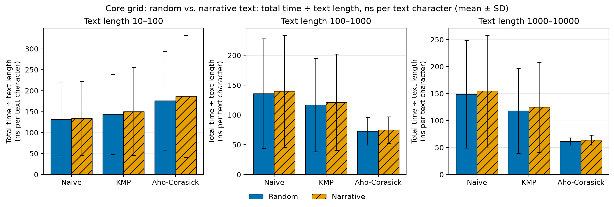

### Figure 5.2b. Core grid: random vs. narrative text: comparisons (prep + search) ÷ text length (comparisons per text character)

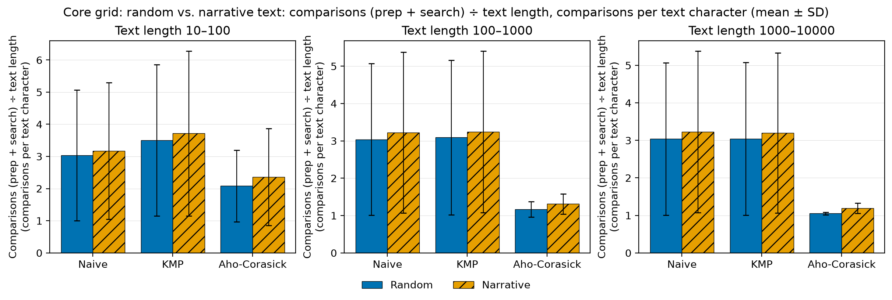

### Figure 5.2c. Core grid: random vs. narrative text: memory use (structure bytes) (bytes)

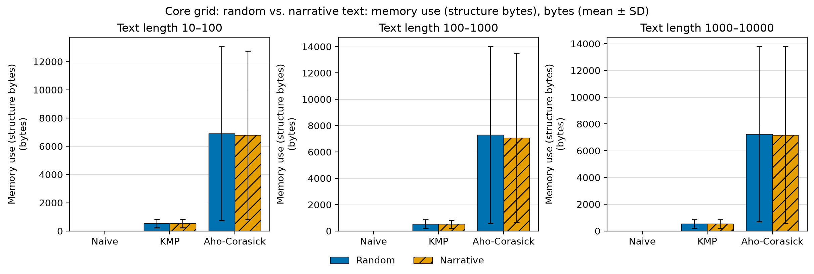

### Figure 5.3a. Core grid: 1 vs. 5 queries: total time ÷ text length (ns per text character)

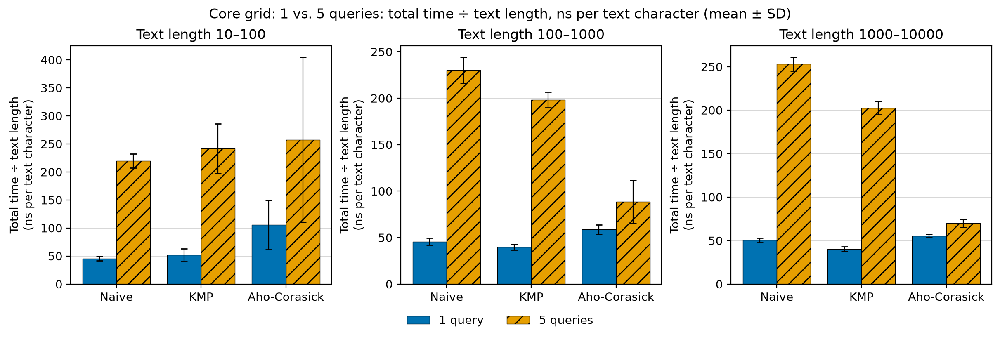

### Figure 5.3b. Core grid: 1 vs. 5 queries: comparisons (prep + search) ÷ text length (comparisons per text character)

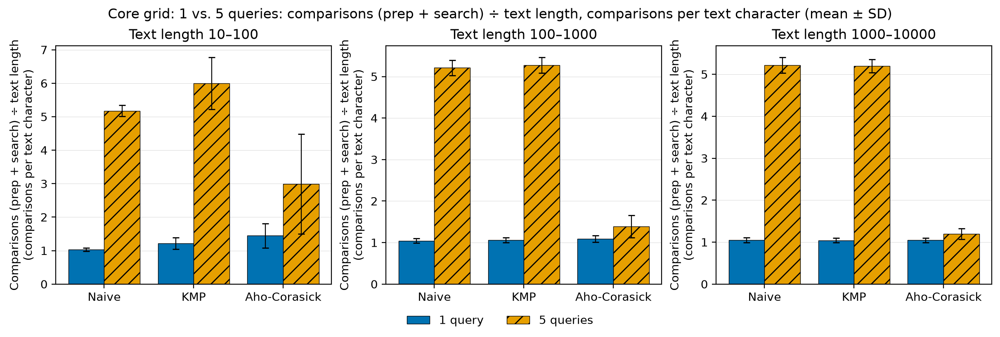

### Figure 5.3c. Core grid: 1 vs. 5 queries: memory use (structure bytes) (bytes)

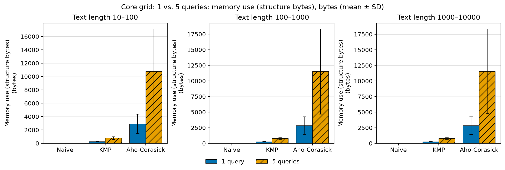

### Figure 5.4a. Query-pattern experiment: distinct vs. repeating: total time ÷ text length (ns per text character)

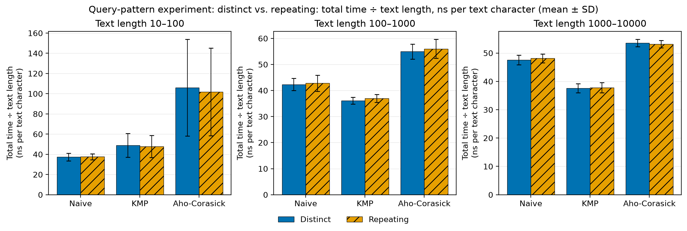

### Figure 5.4b. Query-pattern experiment: distinct vs. repeating: comparisons (prep + search) ÷ text length (comparisons per text character)

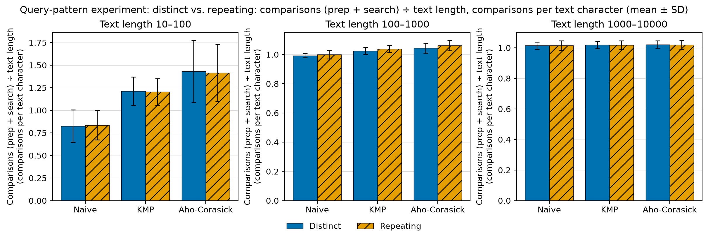

### Figure 5.4c. Query-pattern experiment: distinct vs. repeating: memory use (structure bytes) (bytes)

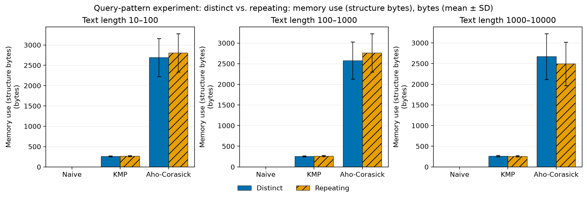

### Figure 5.5a. Alphabet-size experiment: total time ÷ text length (ns per text character)

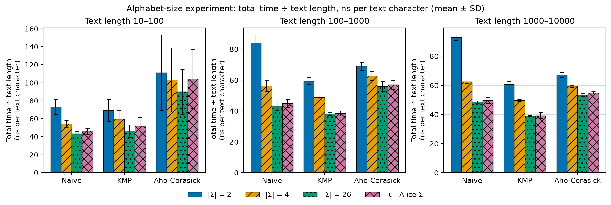

### Figure 5.5b. Alphabet-size experiment: comparisons (prep + search) ÷ text length (comparisons per text character)

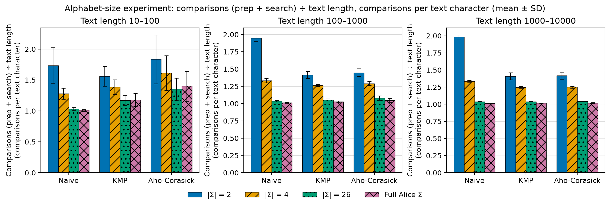

### Figure 5.5c. Alphabet-size experiment: memory use (structure bytes) (bytes)

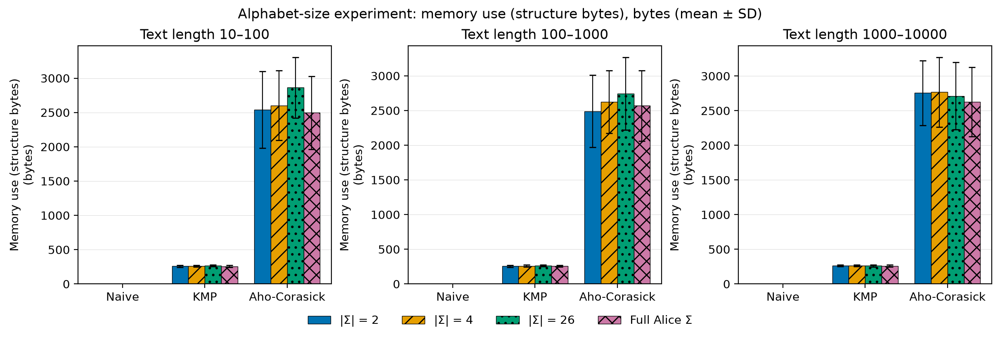

## Appendix: unnormalized results

The first analysis, before normalization: time = total time per call (µs) and comparisons = prep + search comparisons, not divided by text length; memory = `memory_bytes` (bytes), as in the main analysis. Same groups, pooling, test selection and effect sizes, with its own Holm correction across all 81 tests. The memory tests have the same raw p-values as in the main analysis, but their Holm-adjusted p-values can differ because the other tests in the family differ.

### Decisions summary (unnormalized)

**20 of 81 null hypotheses rejected after Holm's correction.**

| Hypothesis | Tests | Reject | Fail to reject | Not applicable |
| --- | ---: | ---: | ---: | ---: |
| H0-1 | 9 | 0 | 9 | 0 |
| H0-2 | 9 | 0 | 9 | 0 |
| H0-3 | 6 | 0 | 6 | 0 |
| H0-4 | 3 | 3 | 0 | 0 |
| H0-5 | 3 | 2 | 1 | 0 |
| H0-6 | 3 | 3 | 0 | 0 |
| H0-7 | 9 | 0 | 9 | 0 |
| H0-8 | 9 | 0 | 9 | 0 |
| H0-9 | 6 | 0 | 6 | 0 |
| H0-10 | 9 | 6 | 3 | 0 |
| H0-11 | 9 | 6 | 3 | 0 |
| H0-12 | 6 | 0 | 6 | 0 |
| **Total** | 81 | 20 | 61 | 0 |

| # | Hypothesis | Algorithm | Text length | Test | Holm-adjusted p | Decision |
| ---: | --- | --- | --- | --- | ---: | --- |
| 1 | H0-1 | Naive | 10–100 | Mann-Whitney U | 1.0000 | Fail to reject H0 |
| 2 | H0-1 | Naive | 100–1000 | Mann-Whitney U | 1.0000 | Fail to reject H0 |
| 3 | H0-1 | Naive | 1000–10000 | Mann-Whitney U | 1.0000 | Fail to reject H0 |
| 4 | H0-1 | KMP | 10–100 | Mann-Whitney U | 1.0000 | Fail to reject H0 |
| 5 | H0-1 | KMP | 100–1000 | Mann-Whitney U | 1.0000 | Fail to reject H0 |
| 6 | H0-1 | KMP | 1000–10000 | Mann-Whitney U | 1.0000 | Fail to reject H0 |
| 7 | H0-1 | Aho-Corasick | 10–100 | Mann-Whitney U | 1.0000 | Fail to reject H0 |
| 8 | H0-1 | Aho-Corasick | 100–1000 | Mann-Whitney U | 1.0000 | Fail to reject H0 |
| 9 | H0-1 | Aho-Corasick | 1000–10000 | Mann-Whitney U | 1.0000 | Fail to reject H0 |
| 10 | H0-2 | Naive | 10–100 | Mann-Whitney U | 1.0000 | Fail to reject H0 |
| 11 | H0-2 | Naive | 100–1000 | Mann-Whitney U | 1.0000 | Fail to reject H0 |
| 12 | H0-2 | Naive | 1000–10000 | Mann-Whitney U | 1.0000 | Fail to reject H0 |
| 13 | H0-2 | KMP | 10–100 | Mann-Whitney U | 1.0000 | Fail to reject H0 |
| 14 | H0-2 | KMP | 100–1000 | Mann-Whitney U | 1.0000 | Fail to reject H0 |
| 15 | H0-2 | KMP | 1000–10000 | Mann-Whitney U | 1.0000 | Fail to reject H0 |
| 16 | H0-2 | Aho-Corasick | 10–100 | Mann-Whitney U | 1.0000 | Fail to reject H0 |
| 17 | H0-2 | Aho-Corasick | 100–1000 | Mann-Whitney U | 1.0000 | Fail to reject H0 |
| 18 | H0-2 | Aho-Corasick | 1000–10000 | Mann-Whitney U | 1.0000 | Fail to reject H0 |
| 19 | H0-3 | KMP | 10–100 | Mann-Whitney U | 1.0000 | Fail to reject H0 |
| 20 | H0-3 | KMP | 100–1000 | Mann-Whitney U | 1.0000 | Fail to reject H0 |
| 21 | H0-3 | KMP | 1000–10000 | Mann-Whitney U | 1.0000 | Fail to reject H0 |
| 22 | H0-3 | Aho-Corasick | 10–100 | Mann-Whitney U | 1.0000 | Fail to reject H0 |
| 23 | H0-3 | Aho-Corasick | 100–1000 | Mann-Whitney U | 1.0000 | Fail to reject H0 |
| 24 | H0-3 | Aho-Corasick | 1000–10000 | Mann-Whitney U | 1.0000 | Fail to reject H0 |
| 25 | H0-4 | Aho-Corasick | 10–100 | Mann-Whitney U | 3.08e-43 | **Reject H0** |
| 26 | H0-4 | Aho-Corasick | 100–1000 | Mann-Whitney U | 4.11e-13 | **Reject H0** |
| 27 | H0-4 | Aho-Corasick | 1000–10000 | Mann-Whitney U | 0.0036 | **Reject H0** |
| 28 | H0-5 | Aho-Corasick | 10–100 | Mann-Whitney U | 3.40e-29 | **Reject H0** |
| 29 | H0-5 | Aho-Corasick | 100–1000 | Mann-Whitney U | 7.20e-05 | **Reject H0** |
| 30 | H0-5 | Aho-Corasick | 1000–10000 | Mann-Whitney U | 1.0000 | Fail to reject H0 |
| 31 | H0-6 | Aho-Corasick | 10–100 | Mann-Whitney U | 2.08e-40 | **Reject H0** |
| 32 | H0-6 | Aho-Corasick | 100–1000 | Mann-Whitney U | 1.54e-43 | **Reject H0** |
| 33 | H0-6 | Aho-Corasick | 1000–10000 | Mann-Whitney U | 4.75e-43 | **Reject H0** |
| 34 | H0-7 | Naive | 10–100 | Welch's t-test | 1.0000 | Fail to reject H0 |
| 35 | H0-7 | Naive | 100–1000 | Mann-Whitney U | 1.0000 | Fail to reject H0 |
| 36 | H0-7 | Naive | 1000–10000 | Mann-Whitney U | 1.0000 | Fail to reject H0 |
| 37 | H0-7 | KMP | 10–100 | Mann-Whitney U | 1.0000 | Fail to reject H0 |
| 38 | H0-7 | KMP | 100–1000 | Mann-Whitney U | 1.0000 | Fail to reject H0 |
| 39 | H0-7 | KMP | 1000–10000 | Mann-Whitney U | 1.0000 | Fail to reject H0 |
| 40 | H0-7 | Aho-Corasick | 10–100 | Mann-Whitney U | 1.0000 | Fail to reject H0 |
| 41 | H0-7 | Aho-Corasick | 100–1000 | Welch's t-test | 1.0000 | Fail to reject H0 |
| 42 | H0-7 | Aho-Corasick | 1000–10000 | Mann-Whitney U | 1.0000 | Fail to reject H0 |
| 43 | H0-8 | Naive | 10–100 | Welch's t-test | 1.0000 | Fail to reject H0 |
| 44 | H0-8 | Naive | 100–1000 | Welch's t-test | 1.0000 | Fail to reject H0 |
| 45 | H0-8 | Naive | 1000–10000 | Mann-Whitney U | 1.0000 | Fail to reject H0 |
| 46 | H0-8 | KMP | 10–100 | Mann-Whitney U | 1.0000 | Fail to reject H0 |
| 47 | H0-8 | KMP | 100–1000 | Welch's t-test | 1.0000 | Fail to reject H0 |
| 48 | H0-8 | KMP | 1000–10000 | Mann-Whitney U | 1.0000 | Fail to reject H0 |
| 49 | H0-8 | Aho-Corasick | 10–100 | Mann-Whitney U | 1.0000 | Fail to reject H0 |
| 50 | H0-8 | Aho-Corasick | 100–1000 | Welch's t-test | 1.0000 | Fail to reject H0 |
| 51 | H0-8 | Aho-Corasick | 1000–10000 | Mann-Whitney U | 1.0000 | Fail to reject H0 |
| 52 | H0-9 | KMP | 10–100 | Mann-Whitney U | 1.0000 | Fail to reject H0 |
| 53 | H0-9 | KMP | 100–1000 | Mann-Whitney U | 1.0000 | Fail to reject H0 |
| 54 | H0-9 | KMP | 1000–10000 | Mann-Whitney U | 1.0000 | Fail to reject H0 |
| 55 | H0-9 | Aho-Corasick | 10–100 | Mann-Whitney U | 1.0000 | Fail to reject H0 |
| 56 | H0-9 | Aho-Corasick | 100–1000 | Mann-Whitney U | 1.0000 | Fail to reject H0 |
| 57 | H0-9 | Aho-Corasick | 1000–10000 | Mann-Whitney U | 1.0000 | Fail to reject H0 |
| 58 | H0-10 | Naive | 10–100 | One-way ANOVA | 0.0003 | **Reject H0** |
| 59 | H0-10 | Naive | 100–1000 | Kruskal-Wallis | 0.0003 | **Reject H0** |
| 60 | H0-10 | Naive | 1000–10000 | Kruskal-Wallis | 0.0001 | **Reject H0** |
| 61 | H0-10 | KMP | 10–100 | One-way ANOVA | 0.0063 | **Reject H0** |
| 62 | H0-10 | KMP | 100–1000 | Kruskal-Wallis | 0.0052 | **Reject H0** |
| 63 | H0-10 | KMP | 1000–10000 | Kruskal-Wallis | 0.0051 | **Reject H0** |
| 64 | H0-10 | Aho-Corasick | 10–100 | One-way ANOVA | 0.7479 | Fail to reject H0 |
| 65 | H0-10 | Aho-Corasick | 100–1000 | Kruskal-Wallis | 0.2760 | Fail to reject H0 |
| 66 | H0-10 | Aho-Corasick | 1000–10000 | Kruskal-Wallis | 0.8075 | Fail to reject H0 |
| 67 | H0-11 | Naive | 10–100 | One-way ANOVA | 0.0002 | **Reject H0** |
| 68 | H0-11 | Naive | 100–1000 | Kruskal-Wallis | 6.07e-05 | **Reject H0** |
| 69 | H0-11 | Naive | 1000–10000 | Kruskal-Wallis | 4.10e-05 | **Reject H0** |
| 70 | H0-11 | KMP | 10–100 | One-way ANOVA | 0.0711 | Fail to reject H0 |
| 71 | H0-11 | KMP | 100–1000 | Kruskal-Wallis | 0.0766 | Fail to reject H0 |
| 72 | H0-11 | KMP | 1000–10000 | Kruskal-Wallis | 0.0432 | **Reject H0** |
| 73 | H0-11 | Aho-Corasick | 10–100 | One-way ANOVA | 0.0268 | **Reject H0** |
| 74 | H0-11 | Aho-Corasick | 100–1000 | Kruskal-Wallis | 0.0675 | Fail to reject H0 |
| 75 | H0-11 | Aho-Corasick | 1000–10000 | Kruskal-Wallis | 0.0411 | **Reject H0** |
| 76 | H0-12 | KMP | 10–100 | Kruskal-Wallis | 1.0000 | Fail to reject H0 |
| 77 | H0-12 | KMP | 100–1000 | Kruskal-Wallis | 1.0000 | Fail to reject H0 |
| 78 | H0-12 | KMP | 1000–10000 | Kruskal-Wallis | 1.0000 | Fail to reject H0 |
| 79 | H0-12 | Aho-Corasick | 10–100 | Kruskal-Wallis | 1.0000 | Fail to reject H0 |
| 80 | H0-12 | Aho-Corasick | 100–1000 | Kruskal-Wallis | 1.0000 | Fail to reject H0 |
| 81 | H0-12 | Aho-Corasick | 1000–10000 | Kruskal-Wallis | 1.0000 | Fail to reject H0 |

### H0-1 (unnormalized): There is no significant difference in completion time between random text and narrative text, for each algorithm.

H0-1: There is no significant difference in completion time between random text and narrative text, for each algorithm.

*Experiment: `core` (pooled over the 3 query lengths and both query counts). Dependent variable: total time (µs). Algorithms tested: Naive, KMP, Aho-Corasick.*

| Algorithm | Text length | Group stats (mean ± SD, median) | Normality result | Test used | Statistic | Raw p | Holm-adjusted p | Decision | Effect size (label) |
| --- | --- | --- | --- | --- | --- | ---: | ---: | --- | --- |
| Naive | 10–100 | Random: 7.43 ± 6.30 (Mdn 4.11, n = 180) Narrative: 7.51 ± 6.36 (Mdn 4.10, n = 180) | Random: W = 0.852, p = 3.28e-12 ✗ not normal Narrative: W = 0.842, p = 1.09e-12 ✗ not normal | Mann-Whitney U | U = 15,806.0 | 0.6902 | 1.0000 | Fail to reject H0 | δ = -0.024 (negligible); Narrative > Random |
| Naive | 100–1000 | Random: 79.53 ± 71.19 (Mdn 40.41, n = 180) Narrative: 78.55 ± 73.69 (Mdn 42.36, n = 180) | Random: W = 0.839, p = 8.03e-13 ✗ not normal Narrative: W = 0.823, p = 1.70e-13 ✗ not normal | Mann-Whitney U | U = 16,257.0 | 0.9544 | 1.0000 | Fail to reject H0 | δ = +0.004 (negligible); Random > Narrative |
| Naive | 1000–10000 | Random: 876.06 ± 744.85 (Mdn 481.50, n = 180) Narrative: 852.16 ± 755.76 (Mdn 491.66, n = 180) | Random: W = 0.853, p = 3.42e-12 ✗ not normal Narrative: W = 0.846, p = 1.58e-12 ✗ not normal | Mann-Whitney U | U = 16,323.0 | 0.9013 | 1.0000 | Fail to reject H0 | δ = +0.008 (negligible); Random > Narrative |
| KMP | 10–100 | Random: 7.84 ± 6.42 (Mdn 4.20, n = 180) Narrative: 7.96 ± 6.30 (Mdn 4.62, n = 180) | Random: W = 0.851, p = 2.88e-12 ✗ not normal Narrative: W = 0.858, p = 5.85e-12 ✗ not normal | Mann-Whitney U | U = 15,699.0 | 0.6122 | 1.0000 | Fail to reject H0 | δ = -0.031 (negligible); Narrative > Random |
| KMP | 100–1000 | Random: 66.98 ± 58.83 (Mdn 34.47, n = 180) Narrative: 66.66 ± 60.91 (Mdn 37.02, n = 180) | Random: W = 0.841, p = 1.00e-12 ✗ not normal Narrative: W = 0.830, p = 3.29e-13 ✗ not normal | Mann-Whitney U | U = 16,198.0 | 0.9988 | 1.0000 | Fail to reject H0 | δ = -0.000 (negligible); Narrative > Random |
| KMP | 1000–10000 | Random: 694.06 ± 589.10 (Mdn 378.59, n = 180) Narrative: 684.71 ± 605.22 (Mdn 409.06, n = 180) | Random: W = 0.853, p = 3.58e-12 ✗ not normal Narrative: W = 0.847, p = 1.83e-12 ✗ not normal | Mann-Whitney U | U = 16,135.0 | 0.9479 | 1.0000 | Fail to reject H0 | δ = -0.004 (negligible); Narrative > Random |
| Aho-Corasick | 10–100 | Random: 8.86 ± 5.76 (Mdn 6.70, n = 180) Narrative: 8.79 ± 5.24 (Mdn 6.84, n = 180) | Random: W = 0.856, p = 5.06e-12 ✗ not normal Narrative: W = 0.892, p = 3.66e-10 ✗ not normal | Mann-Whitney U | U = 15,916.0 | 0.7740 | 1.0000 | Fail to reject H0 | δ = -0.018 (negligible); Narrative > Random |
| Aho-Corasick | 100–1000 | Random: 38.97 ± 18.05 (Mdn 39.49, n = 180) Narrative: 38.41 ± 19.12 (Mdn 36.07, n = 180) | Random: W = 0.975, p = 0.0027 ✗ not normal Narrative: W = 0.958, p = 3.30e-05 ✗ not normal | Mann-Whitney U | U = 16,639.0 | 0.6569 | 1.0000 | Fail to reject H0 | δ = +0.027 (negligible); Random > Narrative |
| Aho-Corasick | 1000–10000 | Random: 358.82 ± 161.60 (Mdn 360.03, n = 180) Narrative: 349.46 ± 175.50 (Mdn 360.81, n = 180) | Random: W = 0.967, p = 0.0003 ✗ not normal Narrative: W = 0.968, p = 0.0004 ✗ not normal | Mann-Whitney U | U = 16,800.0 | 0.5437 | 1.0000 | Fail to reject H0 | δ = +0.037 (negligible); Random > Narrative |

*Group stats in µs.*

### H0-2 (unnormalized): There is no significant difference in character comparisons between random text and narrative text, for each algorithm.

H0-2: There is no significant difference in character comparisons between random text and narrative text, for each algorithm.

*Experiment: `core` (pooled over the 3 query lengths and both query counts). Dependent variable: comparisons (prep + search) (comparisons). Algorithms tested: Naive, KMP, Aho-Corasick.*

| Algorithm | Text length | Group stats (mean ± SD, median) | Normality result | Test used | Statistic | Raw p | Holm-adjusted p | Decision | Effect size (label) |
| --- | --- | --- | --- | --- | --- | ---: | ---: | --- | --- |
| Naive | 10–100 | Random: 174.4 ± 151.5 (Mdn 97.0, n = 180) Narrative: 181.2 ± 157.6 (Mdn 98.5, n = 180) | Random: W = 0.849, p = 2.32e-12 ✗ not normal Narrative: W = 0.840, p = 8.57e-13 ✗ not normal | Mann-Whitney U | U = 15,500.0 | 0.4786 | 1.0000 | Fail to reject H0 | δ = -0.043 (negligible); Narrative > Random |
| Naive | 100–1000 | Random: 1,738.5 ± 1,513.0 (Mdn 880.5, n = 180) Narrative: 1,761.8 ± 1,595.6 (Mdn 998.0, n = 180) | Random: W = 0.842, p = 1.04e-12 ✗ not normal Narrative: W = 0.834, p = 4.61e-13 ✗ not normal | Mann-Whitney U | U = 15,960.5 | 0.8087 | 1.0000 | Fail to reject H0 | δ = -0.015 (negligible); Narrative > Random |
| Naive | 1000–10000 | Random: 17,846.4 ± 15,071.2 (Mdn 9,832.0, n = 180) Narrative: 17,714.5 ± 15,610.6 (Mdn 10,207.0, n = 180) | Random: W = 0.854, p = 3.89e-12 ✗ not normal Narrative: W = 0.846, p = 1.58e-12 ✗ not normal | Mann-Whitney U | U = 16,079.0 | 0.9029 | 1.0000 | Fail to reject H0 | δ = -0.007 (negligible); Narrative > Random |
| KMP | 10–100 | Random: 197.0 ± 167.4 (Mdn 104.5, n = 180) Narrative: 203.3 ± 168.5 (Mdn 116.5, n = 180) | Random: W = 0.848, p = 2.01e-12 ✗ not normal Narrative: W = 0.853, p = 3.60e-12 ✗ not normal | Mann-Whitney U | U = 15,543.0 | 0.5061 | 1.0000 | Fail to reject H0 | δ = -0.041 (negligible); Narrative > Random |
| KMP | 100–1000 | Random: 1,761.5 ± 1,526.5 (Mdn 905.0, n = 180) Narrative: 1,766.0 ± 1,591.6 (Mdn 997.5, n = 180) | Random: W = 0.842, p = 1.13e-12 ✗ not normal Narrative: W = 0.834, p = 4.91e-13 ✗ not normal | Mann-Whitney U | U = 16,123.5 | 0.9386 | 1.0000 | Fail to reject H0 | δ = -0.005 (negligible); Narrative > Random |
| KMP | 1000–10000 | Random: 17,866.1 ± 15,081.4 (Mdn 9,842.0, n = 180) Narrative: 17,545.3 ± 15,448.2 (Mdn 10,057.5, n = 180) | Random: W = 0.854, p = 3.91e-12 ✗ not normal Narrative: W = 0.846, p = 1.68e-12 ✗ not normal | Mann-Whitney U | U = 16,205.0 | 0.9964 | 1.0000 | Fail to reject H0 | δ = +0.000 (negligible); Random > Narrative |
| Aho-Corasick | 10–100 | Random: 108.6 ± 61.5 (Mdn 89.0, n = 180) Narrative: 117.5 ± 62.7 (Mdn 103.0, n = 180) | Random: W = 0.910, p = 4.83e-09 ✗ not normal Narrative: W = 0.943, p = 1.32e-06 ✗ not normal | Mann-Whitney U | U = 14,614.0 | 0.1083 | 1.0000 | Fail to reject H0 | δ = -0.098 (negligible); Narrative > Random |
| Aho-Corasick | 100–1000 | Random: 638.0 ± 279.7 (Mdn 651.0, n = 180) Narrative: 684.9 ± 340.2 (Mdn 651.0, n = 180) | Random: W = 0.969, p = 0.0005 ✗ not normal Narrative: W = 0.960, p = 5.42e-05 ✗ not normal | Mann-Whitney U | U = 15,209.5 | 0.3160 | 1.0000 | Fail to reject H0 | δ = -0.061 (negligible); Narrative > Random |
| Aho-Corasick | 1000–10000 | Random: 6,133.9 ± 2,689.2 (Mdn 6,248.0, n = 180) Narrative: 6,548.6 ± 3,287.6 (Mdn 6,621.5, n = 180) | Random: W = 0.950, p = 5.71e-06 ✗ not normal Narrative: W = 0.962, p = 8.19e-05 ✗ not normal | Mann-Whitney U | U = 15,153.0 | 0.2891 | 1.0000 | Fail to reject H0 | δ = -0.065 (negligible); Narrative > Random |

*Group stats in comparisons.*

### H0-3 (unnormalized): There is no significant difference in memory use between random text and narrative text, for each algorithm.

H0-3: There is no significant difference in memory use between random text and narrative text, for each algorithm.

*Experiment: `core` (pooled over the 3 query lengths and both query counts). Dependent variable: memory use (structure bytes) (bytes). Algorithms tested: KMP, Aho-Corasick.*

| Algorithm | Text length | Group stats (mean ± SD, median) | Normality result | Test used | Statistic | Raw p | Holm-adjusted p | Decision | Effect size (label) |
| --- | --- | --- | --- | --- | --- | ---: | ---: | --- | --- |
| KMP | 10–100 | Random: 531 ± 300 (Mdn 444, n = 180) Narrative: 532 ± 301 (Mdn 448, n = 180) | Random: W = 0.866, p = 1.52e-11 ✗ not normal Narrative: W = 0.863, p = 1.03e-11 ✗ not normal | Mann-Whitney U | U = 16,109.0 | 0.9269 | 1.0000 | Fail to reject H0 | δ = -0.006 (negligible); Narrative > Random |
| KMP | 100–1000 | Random: 536 ± 309 (Mdn 444, n = 180) Narrative: 530 ± 302 (Mdn 436, n = 180) | Random: W = 0.856, p = 5.03e-12 ✗ not normal Narrative: W = 0.861, p = 8.43e-12 ✗ not normal | Mann-Whitney U | U = 16,422.0 | 0.8224 | 1.0000 | Fail to reject H0 | δ = +0.014 (negligible); Random > Narrative |
| KMP | 1000–10000 | Random: 533 ± 304 (Mdn 448, n = 180) Narrative: 533 ± 307 (Mdn 440, n = 180) | Random: W = 0.865, p = 1.41e-11 ✗ not normal Narrative: W = 0.857, p = 5.66e-12 ✗ not normal | Mann-Whitney U | U = 16,157.5 | 0.9661 | 1.0000 | Fail to reject H0 | δ = -0.003 (negligible); Narrative > Random |
| Aho-Corasick | 10–100 | Random: 6,916 ± 6,153 (Mdn 4,284, n = 180) Narrative: 6,784 ± 5,980 (Mdn 4,036, n = 180) | Random: W = 0.806, p = 3.36e-14 ✗ not normal Narrative: W = 0.807, p = 3.60e-14 ✗ not normal | Mann-Whitney U | U = 16,453.5 | 0.7977 | 1.0000 | Fail to reject H0 | δ = +0.016 (negligible); Random > Narrative |
| Aho-Corasick | 100–1000 | Random: 7,309 ± 6,694 (Mdn 4,192, n = 180) Narrative: 7,078 ± 6,430 (Mdn 4,272, n = 180) | Random: W = 0.789, p = 7.90e-15 ✗ not normal Narrative: W = 0.787, p = 6.69e-15 ✗ not normal | Mann-Whitney U | U = 16,493.0 | 0.7670 | 1.0000 | Fail to reject H0 | δ = +0.018 (negligible); Random > Narrative |
| Aho-Corasick | 1000–10000 | Random: 7,237 ± 6,547 (Mdn 4,192, n = 180) Narrative: 7,168 ± 6,604 (Mdn 4,272, n = 180) | Random: W = 0.806, p = 3.25e-14 ✗ not normal Narrative: W = 0.783, p = 4.82e-15 ✗ not normal | Mann-Whitney U | U = 16,355.0 | 0.8756 | 1.0000 | Fail to reject H0 | δ = +0.010 (negligible); Random > Narrative |

*Group stats in bytes.*

### H0-4 (unnormalized): There is no significant difference in completion time between different numbers of query strings for the Aho-Corasick algorithm.

H0-4: There is no significant difference in completion time between different numbers of query strings for the Aho-Corasick algorithm.

*Experiment: `core` (pooled over both text types and the 3 query lengths). Dependent variable: total time (µs). Algorithms tested: Aho-Corasick.*

| Algorithm | Text length | Group stats (mean ± SD, median) | Normality result | Test used | Statistic | Raw p | Holm-adjusted p | Decision | Effect size (label) |
| --- | --- | --- | --- | --- | --- | ---: | ---: | --- | --- |
| Aho-Corasick | 10–100 | 1 query: 5.07 ± 1.70 (Mdn 5.03, n = 180) 5 queries: 12.59 ± 5.40 (Mdn 12.21, n = 180) | 1 query: W = 0.990, p = 0.2631 ✓ normal 5 queries: W = 0.949, p = 4.89e-06 ✗ not normal | Mann-Whitney U | U = 2,280.0 | 3.85e-45 | 3.08e-43 | **Reject H0** | δ = -0.859 (large); 5 queries > 1 query |
| Aho-Corasick | 100–1000 | 1 query: 30.75 ± 14.35 (Mdn 30.47, n = 180) 5 queries: 46.63 ± 18.94 (Mdn 47.50, n = 180) | 1 query: W = 0.960, p = 5.24e-05 ✗ not normal 5 queries: W = 0.964, p = 0.0001 ✗ not normal | Mann-Whitney U | U = 8,482.0 | 5.41e-15 | 4.11e-13 | **Reject H0** | δ = -0.476 (large); 5 queries > 1 query |
| Aho-Corasick | 1000–10000 | 1 query: 315.64 ± 154.09 (Mdn 338.63, n = 180) 5 queries: 392.64 ± 173.88 (Mdn 380.06, n = 180) | 1 query: W = 0.938, p = 5.59e-07 ✗ not normal 5 queries: W = 0.952, p = 9.42e-06 ✗ not normal | Mann-Whitney U | U = 12,211.0 | 5.35e-05 | 0.0036 | **Reject H0** | δ = -0.246 (small); 5 queries > 1 query |

*Group stats in µs.*

### H0-5 (unnormalized): There is no significant difference in character comparisons between different numbers of query strings for the Aho-Corasick algorithm.

H0-5: There is no significant difference in character comparisons between different numbers of query strings for the Aho-Corasick algorithm.

*Experiment: `core` (pooled over both text types and the 3 query lengths). Dependent variable: comparisons (prep + search) (comparisons). Algorithms tested: Aho-Corasick.*

| Algorithm | Text length | Group stats (mean ± SD, median) | Normality result | Test used | Statistic | Raw p | Holm-adjusted p | Decision | Effect size (label) |
| --- | --- | --- | --- | --- | --- | ---: | ---: | --- | --- |
| Aho-Corasick | 10–100 | 1 query: 74.7 ± 28.9 (Mdn 75.0, n = 180) 5 queries: 151.4 ± 62.9 (Mdn 148.5, n = 180) | 1 query: W = 0.988, p = 0.1452 ✓ normal 5 queries: W = 0.973, p = 0.0016 ✗ not normal | Mann-Whitney U | U = 4,753.5 | 4.42e-31 | 3.40e-29 | **Reject H0** | δ = -0.707 (large); 5 queries > 1 query |
| Aho-Corasick | 100–1000 | 1 query: 575.4 ± 272.4 (Mdn 572.5, n = 180) 5 queries: 747.5 ± 325.6 (Mdn 764.0, n = 180) | 1 query: W = 0.964, p = 0.0001 ✗ not normal 5 queries: W = 0.970, p = 0.0006 ✗ not normal | Mann-Whitney U | U = 11,367.5 | 9.86e-07 | 7.20e-05 | **Reject H0** | δ = -0.298 (medium); 5 queries > 1 query |
| Aho-Corasick | 1000–10000 | 1 query: 5,971.2 ± 2,935.5 (Mdn 6,335.0, n = 180) 5 queries: 6,711.4 ± 3,038.8 (Mdn 6,632.5, n = 180) | 1 query: W = 0.942, p = 1.21e-06 ✗ not normal 5 queries: W = 0.966, p = 0.0003 ✗ not normal | Mann-Whitney U | U = 14,085.5 | 0.0323 | 1.0000 | Fail to reject H0 | δ = -0.131 (small); 5 queries > 1 query |

*Group stats in comparisons.*

### H0-6 (unnormalized): There is no significant difference in memory use between different numbers of query strings for the Aho-Corasick algorithm.

H0-6: There is no significant difference in memory use between different numbers of query strings for the Aho-Corasick algorithm.

*Experiment: `core` (pooled over both text types and the 3 query lengths). Dependent variable: memory use (structure bytes) (bytes). Algorithms tested: Aho-Corasick.*

| Algorithm | Text length | Group stats (mean ± SD, median) | Normality result | Test used | Statistic | Raw p | Holm-adjusted p | Decision | Effect size (label) |
| --- | --- | --- | --- | --- | --- | ---: | ---: | --- | --- |
| Aho-Corasick | 10–100 | 1 query: 2,923 ± 1,469 (Mdn 2,832, n = 180) 5 queries: 10,777 ± 6,361 (Mdn 9,808, n = 180) | 1 query: W = 0.924, p = 4.27e-08 ✗ not normal 5 queries: W = 0.902, p = 1.54e-09 ✗ not normal | Mann-Whitney U | U = 2,747.0 | 2.67e-42 | 2.08e-40 | **Reject H0** | δ = -0.830 (large); 5 queries > 1 query |
| Aho-Corasick | 100–1000 | 1 query: 2,867 ± 1,398 (Mdn 2,832, n = 180) 5 queries: 11,520 ± 6,826 (Mdn 9,808, n = 180) | 1 query: W = 0.934, p = 2.45e-07 ✗ not normal 5 queries: W = 0.881, p = 9.29e-11 ✗ not normal | Mann-Whitney U | U = 2,235.0 | 1.90e-45 | 1.54e-43 | **Reject H0** | δ = -0.862 (large); 5 queries > 1 query |
| Aho-Corasick | 1000–10000 | 1 query: 2,849 ± 1,420 (Mdn 2,616, n = 180) 5 queries: 11,556 ± 6,808 (Mdn 10,048, n = 180) | 1 query: W = 0.931, p = 1.43e-07 ✗ not normal 5 queries: W = 0.889, p = 2.62e-10 ✗ not normal | Mann-Whitney U | U = 2,316.0 | 6.01e-45 | 4.75e-43 | **Reject H0** | δ = -0.857 (large); 5 queries > 1 query |

*Group stats in bytes.*

### H0-7 (unnormalized): There is no significant difference in completion time between query strings of distinct characters and query strings containing repeating substrings, for each algorithm.

H0-7: There is no significant difference in completion time between query strings of distinct characters and query strings containing repeating substrings, for each algorithm.

*Experiment: `query_pattern` (narrative text, one query of length 5–10). Dependent variable: total time (µs). Algorithms tested: Naive, KMP, Aho-Corasick.*

| Algorithm | Text length | Group stats (mean ± SD, median) | Normality result | Test used | Statistic | Raw p | Holm-adjusted p | Decision | Effect size (label) |
| --- | --- | --- | --- | --- | --- | ---: | ---: | --- | --- |
| Naive | 10–100 | Distinct: 1.99 ± 1.03 (Mdn 1.97, n = 30) Repeating: 2.13 ± 1.05 (Mdn 2.11, n = 30) | Distinct: W = 0.935, p = 0.0671 ✓ normal Repeating: W = 0.964, p = 0.3820 ✓ normal | Welch's t-test | t = -0.507 (df = 58.0) | 0.6138 | 1.0000 | Fail to reject H0 | d = -0.131 (negligible); Repeating > Distinct |
| Naive | 100–1000 | Distinct: 22.01 ± 11.81 (Mdn 19.74, n = 30) Repeating: 22.77 ± 11.81 (Mdn 22.37, n = 30) | Distinct: W = 0.925, p = 0.0364 ✗ not normal Repeating: W = 0.931, p = 0.0518 ✓ normal | Mann-Whitney U | U = 435.0 | 0.8303 | 1.0000 | Fail to reject H0 | δ = -0.033 (negligible); Repeating > Distinct |
| Naive | 1000–10000 | Distinct: 233.89 ± 136.13 (Mdn 271.75, n = 30) Repeating: 292.09 ± 114.42 (Mdn 312.72, n = 30) | Distinct: W = 0.921, p = 0.0285 ✗ not normal Repeating: W = 0.954, p = 0.2097 ✓ normal | Mann-Whitney U | U = 330.0 | 0.0773 | 1.0000 | Fail to reject H0 | δ = -0.267 (small); Repeating > Distinct |
| KMP | 10–100 | Distinct: 2.30 ± 0.88 (Mdn 2.25, n = 30) Repeating: 2.43 ± 0.91 (Mdn 2.28, n = 30) | Distinct: W = 0.917, p = 0.0226 ✗ not normal Repeating: W = 0.962, p = 0.3505 ✓ normal | Mann-Whitney U | U = 410.0 | 0.5592 | 1.0000 | Fail to reject H0 | δ = -0.089 (negligible); Repeating > Distinct |
| KMP | 100–1000 | Distinct: 18.35 ± 9.17 (Mdn 16.31, n = 30) Repeating: 19.22 ± 9.38 (Mdn 18.93, n = 30) | Distinct: W = 0.926, p = 0.0379 ✗ not normal Repeating: W = 0.934, p = 0.0610 ✓ normal | Mann-Whitney U | U = 425.0 | 0.7172 | 1.0000 | Fail to reject H0 | δ = -0.056 (negligible); Repeating > Distinct |
| KMP | 1000–10000 | Distinct: 183.86 ± 106.35 (Mdn 214.15, n = 30) Repeating: 228.93 ± 89.22 (Mdn 244.04, n = 30) | Distinct: W = 0.919, p = 0.0251 ✗ not normal Repeating: W = 0.946, p = 0.1341 ✓ normal | Mann-Whitney U | U = 331.0 | 0.0798 | 1.0000 | Fail to reject H0 | δ = -0.264 (small); Repeating > Distinct |
| Aho-Corasick | 10–100 | Distinct: 4.53 ± 1.24 (Mdn 4.66, n = 30) Repeating: 4.76 ± 1.28 (Mdn 4.79, n = 30) | Distinct: W = 0.929, p = 0.0452 ✗ not normal Repeating: W = 0.952, p = 0.1934 ✓ normal | Mann-Whitney U | U = 401.0 | 0.4733 | 1.0000 | Fail to reject H0 | δ = -0.109 (negligible); Repeating > Distinct |
| Aho-Corasick | 100–1000 | Distinct: 27.48 ± 12.94 (Mdn 24.80, n = 30) Repeating: 28.28 ± 12.83 (Mdn 27.96, n = 30) | Distinct: W = 0.933, p = 0.0593 ✓ normal Repeating: W = 0.934, p = 0.0630 ✓ normal | Welch's t-test | t = -0.240 (df = 58.0) | 0.8108 | 1.0000 | Fail to reject H0 | d = -0.062 (negligible); Repeating > Distinct |
| Aho-Corasick | 1000–10000 | Distinct: 261.37 ± 151.24 (Mdn 296.53, n = 30) Repeating: 321.77 ± 124.52 (Mdn 340.54, n = 30) | Distinct: W = 0.918, p = 0.0233 ✗ not normal Repeating: W = 0.959, p = 0.2857 ✓ normal | Mann-Whitney U | U = 338.0 | 0.0993 | 1.0000 | Fail to reject H0 | δ = -0.249 (small); Repeating > Distinct |

*Group stats in µs.*

### H0-8 (unnormalized): There is no significant difference in character comparisons between query strings of distinct characters and query strings containing repeating substrings, for each algorithm.

H0-8: There is no significant difference in character comparisons between query strings of distinct characters and query strings containing repeating substrings, for each algorithm.

*Experiment: `query_pattern` (narrative text, one query of length 5–10). Dependent variable: comparisons (prep + search) (comparisons). Algorithms tested: Naive, KMP, Aho-Corasick.*

| Algorithm | Text length | Group stats (mean ± SD, median) | Normality result | Test used | Statistic | Raw p | Holm-adjusted p | Decision | Effect size (label) |
| --- | --- | --- | --- | --- | --- | ---: | ---: | --- | --- |
| Naive | 10–100 | Distinct: 46.2 ± 26.6 (Mdn 45.0, n = 30) Repeating: 49.5 ± 27.2 (Mdn 48.0, n = 30) | Distinct: W = 0.935, p = 0.0662 ✓ normal Repeating: W = 0.960, p = 0.3142 ✓ normal | Welch's t-test | t = -0.471 (df = 58.0) | 0.6397 | 1.0000 | Fail to reject H0 | d = -0.122 (negligible); Repeating > Distinct |
| Naive | 100–1000 | Distinct: 504.7 ± 248.8 (Mdn 462.0, n = 30) Repeating: 520.7 ± 253.2 (Mdn 513.0, n = 30) | Distinct: W = 0.935, p = 0.0678 ✓ normal Repeating: W = 0.938, p = 0.0810 ✓ normal | Welch's t-test | t = -0.248 (df = 58.0) | 0.8051 | 1.0000 | Fail to reject H0 | d = -0.064 (negligible); Repeating > Distinct |
| Naive | 1000–10000 | Distinct: 4,951.7 ± 2,845.3 (Mdn 5,745.0, n = 30) Repeating: 6,151.2 ± 2,393.6 (Mdn 6,598.5, n = 30) | Distinct: W = 0.917, p = 0.0224 ✗ not normal Repeating: W = 0.953, p = 0.2071 ✓ normal | Mann-Whitney U | U = 333.0 | 0.0850 | 1.0000 | Fail to reject H0 | δ = -0.260 (small); Repeating > Distinct |
| KMP | 10–100 | Distinct: 59.7 ± 26.4 (Mdn 59.0, n = 30) Repeating: 63.9 ± 27.1 (Mdn 60.0, n = 30) | Distinct: W = 0.921, p = 0.0288 ✗ not normal Repeating: W = 0.959, p = 0.2946 ✓ normal | Mann-Whitney U | U = 405.5 | 0.5152 | 1.0000 | Fail to reject H0 | δ = -0.099 (negligible); Repeating > Distinct |
| KMP | 100–1000 | Distinct: 517.3 ± 248.9 (Mdn 472.0, n = 30) Repeating: 534.6 ± 252.5 (Mdn 528.5, n = 30) | Distinct: W = 0.935, p = 0.0655 ✓ normal Repeating: W = 0.938, p = 0.0797 ✓ normal | Welch's t-test | t = -0.267 (df = 58.0) | 0.7906 | 1.0000 | Fail to reject H0 | d = -0.069 (negligible); Repeating > Distinct |
| KMP | 1000–10000 | Distinct: 4,965.0 ± 2,845.8 (Mdn 5,756.0, n = 30) Repeating: 6,160.2 ± 2,392.4 (Mdn 6,591.5, n = 30) | Distinct: W = 0.917, p = 0.0221 ✗ not normal Repeating: W = 0.954, p = 0.2147 ✓ normal | Mann-Whitney U | U = 333.0 | 0.0850 | 1.0000 | Fail to reject H0 | δ = -0.260 (small); Repeating > Distinct |
| Aho-Corasick | 10–100 | Distinct: 67.5 ± 26.4 (Mdn 68.0, n = 30) Repeating: 72.0 ± 27.2 (Mdn 70.0, n = 30) | Distinct: W = 0.919, p = 0.0257 ✗ not normal Repeating: W = 0.963, p = 0.3687 ✓ normal | Mann-Whitney U | U = 408.0 | 0.5394 | 1.0000 | Fail to reject H0 | δ = -0.093 (negligible); Repeating > Distinct |
| Aho-Corasick | 100–1000 | Distinct: 524.7 ± 249.1 (Mdn 478.0, n = 30) Repeating: 542.7 ± 252.4 (Mdn 537.5, n = 30) | Distinct: W = 0.934, p = 0.0644 ✓ normal Repeating: W = 0.938, p = 0.0804 ✓ normal | Welch's t-test | t = -0.278 (df = 58.0) | 0.7820 | 1.0000 | Fail to reject H0 | d = -0.072 (negligible); Repeating > Distinct |
| Aho-Corasick | 1000–10000 | Distinct: 4,972.7 ± 2,846.1 (Mdn 5,762.5, n = 30) Repeating: 6,167.3 ± 2,392.8 (Mdn 6,596.5, n = 30) | Distinct: W = 0.917, p = 0.0219 ✗ not normal Repeating: W = 0.954, p = 0.2150 ✓ normal | Mann-Whitney U | U = 333.0 | 0.0850 | 1.0000 | Fail to reject H0 | δ = -0.260 (small); Repeating > Distinct |

*Group stats in comparisons.*

### H0-9 (unnormalized): There is no significant difference in memory use between query strings of distinct characters and query strings containing repeating substrings, for each algorithm.

H0-9: There is no significant difference in memory use between query strings of distinct characters and query strings containing repeating substrings, for each algorithm.

*Experiment: `query_pattern` (narrative text, one query of length 5–10). Dependent variable: memory use (structure bytes) (bytes). Algorithms tested: KMP, Aho-Corasick.*

| Algorithm | Text length | Group stats (mean ± SD, median) | Normality result | Test used | Statistic | Raw p | Holm-adjusted p | Decision | Effect size (label) |
| --- | --- | --- | --- | --- | --- | ---: | ---: | --- | --- |
| KMP | 10–100 | Distinct: 262 ± 13 (Mdn 264, n = 30) Repeating: 265 ± 13 (Mdn 268, n = 30) | Distinct: W = 0.917, p = 0.0228 ✗ not normal Repeating: W = 0.891, p = 0.0052 ✗ not normal | Mann-Whitney U | U = 377.0 | 0.2754 | 1.0000 | Fail to reject H0 | δ = -0.162 (small); Repeating > Distinct |
| KMP | 100–1000 | Distinct: 259 ± 12 (Mdn 260, n = 30) Repeating: 264 ± 13 (Mdn 264, n = 30) | Distinct: W = 0.900, p = 0.0085 ✗ not normal Repeating: W = 0.906, p = 0.0117 ✗ not normal | Mann-Whitney U | U = 343.5 | 0.1106 | 1.0000 | Fail to reject H0 | δ = -0.237 (small); Repeating > Distinct |
| KMP | 1000–10000 | Distinct: 262 ± 15 (Mdn 264, n = 30) Repeating: 257 ± 15 (Mdn 252, n = 30) | Distinct: W = 0.856, p = 0.0008 ✗ not normal Repeating: W = 0.858, p = 0.0009 ✗ not normal | Mann-Whitney U | U = 535.5 | 0.1999 | 1.0000 | Fail to reject H0 | δ = +0.190 (small); Distinct > Repeating |
| Aho-Corasick | 10–100 | Distinct: 2,691 ± 468 (Mdn 2,832, n = 30) Repeating: 2,808 ± 471 (Mdn 2,952, n = 30) | Distinct: W = 0.895, p = 0.0062 ✗ not normal Repeating: W = 0.864, p = 0.0013 ✗ not normal | Mann-Whitney U | U = 377.0 | 0.2754 | 1.0000 | Fail to reject H0 | δ = -0.162 (small); Repeating > Distinct |
| Aho-Corasick | 100–1000 | Distinct: 2,576 ± 450 (Mdn 2,616, n = 30) Repeating: 2,763 ± 464 (Mdn 2,832, n = 30) | Distinct: W = 0.885, p = 0.0038 ✗ not normal Repeating: W = 0.889, p = 0.0045 ✗ not normal | Mann-Whitney U | U = 343.5 | 0.1106 | 1.0000 | Fail to reject H0 | δ = -0.237 (small); Repeating > Distinct |
| Aho-Corasick | 1000–10000 | Distinct: 2,670 ± 554 (Mdn 2,832, n = 30) Repeating: 2,493 ± 526 (Mdn 2,280, n = 30) | Distinct: W = 0.838, p = 0.0003 ✗ not normal Repeating: W = 0.833, p = 0.0003 ✗ not normal | Mann-Whitney U | U = 535.5 | 0.1999 | 1.0000 | Fail to reject H0 | δ = +0.190 (small); Distinct > Repeating |

*Group stats in bytes.*

### H0-10 (unnormalized): There is no significant difference in completion time between random texts over alphabets of 2, 4, 26, and \|Σ\| characters (\|Σ\| = the full Alice character set), for each algorithm.

H0-10: There is no significant difference in completion time between random texts over alphabets of 2, 4, 26, and \|Σ\| characters (\|Σ\| = the full Alice character set), for each algorithm.

*Experiment: `alphabet` (random text, one query of length 5–10). Dependent variable: total time (µs). Algorithms tested: Naive, KMP, Aho-Corasick.*

| Algorithm | Text length | Group stats (mean ± SD, median) | Normality result | Test used | Statistic | Raw p | Holm-adjusted p | Decision | Effect size (label) |
| --- | --- | --- | --- | --- | --- | ---: | ---: | --- | --- |
| Naive | 10–100 | \|Σ\| = 2: 4.05 ± 1.88 (Mdn 3.96, n = 30) \|Σ\| = 4: 3.14 ± 1.30 (Mdn 3.39, n = 30) \|Σ\| = 26: 2.83 ± 1.01 (Mdn 2.94, n = 30) Full Alice Σ: 2.16 ± 0.95 (Mdn 2.27, n = 30) | |Σ| = 2: W = 0.963, p = 0.3658 ✓ normal |Σ| = 4: W = 0.953, p = 0.1990 ✓ normal |Σ| = 26: W = 0.949, p = 0.1636 ✓ normal Full Alice Σ: W = 0.955, p = 0.2356 ✓ normal | One-way ANOVA | F(3, 116) = 10.288 | 4.67e-06 | 0.0003 | **Reject H0** | η² = 0.210 (large) |
| Naive | 100–1000 | \|Σ\| = 2: 54.17 ± 25.81 (Mdn 58.52, n = 30) \|Σ\| = 4: 28.71 ± 15.64 (Mdn 27.93, n = 30) \|Σ\| = 26: 21.92 ± 12.08 (Mdn 20.14, n = 30) Full Alice Σ: 26.05 ± 13.48 (Mdn 26.23, n = 30) | |Σ| = 2: W = 0.914, p = 0.0190 ✗ not normal |Σ| = 4: W = 0.959, p = 0.2881 ✓ normal |Σ| = 26: W = 0.925, p = 0.0369 ✗ not normal Full Alice Σ: W = 0.912, p = 0.0171 ✗ not normal | Kruskal-Wallis | H = 27.406 (df = 3) | 4.84e-06 | 0.0003 | **Reject H0** | ε² = 0.230 (large) |
| Naive | 1000–10000 | \|Σ\| = 2: 567.93 ± 257.50 (Mdn 646.73, n = 30) \|Σ\| = 4: 379.16 ± 171.86 (Mdn 387.54, n = 30) \|Σ\| = 26: 283.38 ± 128.40 (Mdn 267.45, n = 30) Full Alice Σ: 249.38 ± 116.01 (Mdn 232.93, n = 30) | |Σ| = 2: W = 0.914, p = 0.0186 ✗ not normal |Σ| = 4: W = 0.907, p = 0.0127 ✗ not normal |Σ| = 26: W = 0.940, p = 0.0897 ✓ normal Full Alice Σ: W = 0.967, p = 0.4682 ✓ normal | Kruskal-Wallis | H = 29.521 (df = 3) | 1.74e-06 | 0.0001 | **Reject H0** | ε² = 0.248 (large) |
| KMP | 10–100 | \|Σ\| = 2: 3.58 ± 1.34 (Mdn 3.65, n = 30) \|Σ\| = 4: 3.28 ± 1.17 (Mdn 3.45, n = 30) \|Σ\| = 26: 2.93 ± 0.89 (Mdn 3.04, n = 30) Full Alice Σ: 2.31 ± 0.83 (Mdn 2.35, n = 30) | |Σ| = 2: W = 0.962, p = 0.3434 ✓ normal |Σ| = 4: W = 0.951, p = 0.1768 ✓ normal |Σ| = 26: W = 0.948, p = 0.1461 ✓ normal Full Alice Σ: W = 0.964, p = 0.3819 ✓ normal | One-way ANOVA | F(3, 116) = 7.712 | 9.63e-05 | 0.0063 | **Reject H0** | η² = 0.166 (large) |
| KMP | 100–1000 | \|Σ\| = 2: 37.45 ± 16.64 (Mdn 39.34, n = 30) \|Σ\| = 4: 24.32 ± 12.42 (Mdn 23.69, n = 30) \|Σ\| = 26: 18.76 ± 9.73 (Mdn 17.44, n = 30) Full Alice Σ: 21.90 ± 10.77 (Mdn 21.91, n = 30) | |Σ| = 2: W = 0.926, p = 0.0385 ✗ not normal |Σ| = 4: W = 0.962, p = 0.3473 ✓ normal |Σ| = 26: W = 0.934, p = 0.0620 ✓ normal Full Alice Σ: W = 0.920, p = 0.0270 ✗ not normal | Kruskal-Wallis | H = 21.620 (df = 3) | 7.82e-05 | 0.0052 | **Reject H0** | ε² = 0.182 (large) |
| KMP | 1000–10000 | \|Σ\| = 2: 368.00 ± 163.67 (Mdn 422.49, n = 30) \|Σ\| = 4: 299.12 ± 134.91 (Mdn 301.28, n = 30) \|Σ\| = 26: 226.90 ± 101.77 (Mdn 215.02, n = 30) Full Alice Σ: 196.17 ± 89.58 (Mdn 182.47, n = 30) | |Σ| = 2: W = 0.913, p = 0.0180 ✗ not normal |Σ| = 4: W = 0.911, p = 0.0154 ✗ not normal |Σ| = 26: W = 0.946, p = 0.1317 ✓ normal Full Alice Σ: W = 0.973, p = 0.6217 ✓ normal | Kruskal-Wallis | H = 21.672 (df = 3) | 7.63e-05 | 0.0051 | **Reject H0** | ε² = 0.182 (large) |
| Aho-Corasick | 10–100 | \|Σ\| = 2: 5.35 ± 1.56 (Mdn 5.22, n = 30) \|Σ\| = 4: 5.29 ± 1.38 (Mdn 5.25, n = 30) \|Σ\| = 26: 5.45 ± 1.29 (Mdn 5.69, n = 30) Full Alice Σ: 4.41 ± 1.20 (Mdn 4.28, n = 30) | |Σ| = 2: W = 0.965, p = 0.4244 ✓ normal |Σ| = 4: W = 0.970, p = 0.5373 ✓ normal |Σ| = 26: W = 0.972, p = 0.6090 ✓ normal Full Alice Σ: W = 0.983, p = 0.8908 ✓ normal | One-way ANOVA | F(3, 116) = 3.740 | 0.0131 | 0.7479 | Fail to reject H0 | η² = 0.088 (medium) |
| Aho-Corasick | 100–1000 | \|Σ\| = 2: 43.03 ± 18.46 (Mdn 46.25, n = 30) \|Σ\| = 4: 30.70 ± 14.96 (Mdn 30.25, n = 30) \|Σ\| = 26: 27.02 ± 13.08 (Mdn 25.04, n = 30) Full Alice Σ: 31.87 ± 14.91 (Mdn 32.57, n = 30) | |Σ| = 2: W = 0.920, p = 0.0274 ✗ not normal |Σ| = 4: W = 0.961, p = 0.3308 ✓ normal |Σ| = 26: W = 0.939, p = 0.0862 ✓ normal Full Alice Σ: W = 0.920, p = 0.0268 ✗ not normal | Kruskal-Wallis | H = 12.945 (df = 3) | 0.0048 | 0.2760 | Fail to reject H0 | ε² = 0.109 (medium) |
| Aho-Corasick | 1000–10000 | \|Σ\| = 2: 407.51 ± 180.62 (Mdn 460.93, n = 30) \|Σ\| = 4: 358.56 ± 161.25 (Mdn 365.32, n = 30) \|Σ\| = 26: 309.03 ± 136.88 (Mdn 293.29, n = 30) Full Alice Σ: 273.37 ± 122.83 (Mdn 248.07, n = 30) | |Σ| = 2: W = 0.912, p = 0.0164 ✗ not normal |Σ| = 4: W = 0.911, p = 0.0156 ✗ not normal |Σ| = 26: W = 0.938, p = 0.0809 ✓ normal Full Alice Σ: W = 0.971, p = 0.5609 ✓ normal | Kruskal-Wallis | H = 10.551 (df = 3) | 0.0144 | 0.8075 | Fail to reject H0 | ε² = 0.089 (medium) |

*Group stats in µs.*

### H0-11 (unnormalized): There is no significant difference in character comparisons between random texts over alphabets of 2, 4, 26, and \|Σ\| characters, for each algorithm.

H0-11: There is no significant difference in character comparisons between random texts over alphabets of 2, 4, 26, and \|Σ\| characters, for each algorithm.

*Experiment: `alphabet` (random text, one query of length 5–10). Dependent variable: comparisons (prep + search) (comparisons). Algorithms tested: Naive, KMP, Aho-Corasick.*

| Algorithm | Text length | Group stats (mean ± SD, median) | Normality result | Test used | Statistic | Raw p | Holm-adjusted p | Decision | Effect size (label) |
| --- | --- | --- | --- | --- | --- | ---: | ---: | --- | --- |
| Naive | 10–100 | \|Σ\| = 2: 98.2 ± 48.3 (Mdn 95.5, n = 30) \|Σ\| = 4: 75.9 ± 33.9 (Mdn 82.0, n = 30) \|Σ\| = 26: 68.9 ± 26.5 (Mdn 73.0, n = 30) Full Alice Σ: 48.6 ± 23.2 (Mdn 51.5, n = 30) | |Σ| = 2: W = 0.964, p = 0.3931 ✓ normal |Σ| = 4: W = 0.953, p = 0.2035 ✓ normal |Σ| = 26: W = 0.945, p = 0.1272 ✓ normal Full Alice Σ: W = 0.958, p = 0.2708 ✓ normal | One-way ANOVA | F(3, 116) = 10.635 | 3.13e-06 | 0.0002 | **Reject H0** | η² = 0.216 (large) |
| Naive | 100–1000 | \|Σ\| = 2: 1,230.5 ± 550.8 (Mdn 1,340.5, n = 30) \|Σ\| = 4: 664.5 ± 337.3 (Mdn 652.5, n = 30) \|Σ\| = 26: 511.8 ± 260.9 (Mdn 477.5, n = 30) Full Alice Σ: 574.4 ± 278.5 (Mdn 584.0, n = 30) | |Σ| = 2: W = 0.918, p = 0.0243 ✗ not normal |Σ| = 4: W = 0.965, p = 0.4155 ✓ normal |Σ| = 26: W = 0.937, p = 0.0743 ✓ normal Full Alice Σ: W = 0.922, p = 0.0301 ✗ not normal | Kruskal-Wallis | H = 31.073 (df = 3) | 8.21e-07 | 6.07e-05 | **Reject H0** | ε² = 0.261 (large) |
| Naive | 1000–10000 | \|Σ\| = 2: 12,077.2 ± 5,416.3 (Mdn 13,683.5, n = 30) \|Σ\| = 4: 8,058.1 ± 3,626.2 (Mdn 8,163.5, n = 30) \|Σ\| = 26: 6,032.2 ± 2,694.8 (Mdn 5,733.5, n = 30) Full Alice Σ: 5,046.0 ± 2,259.7 (Mdn 4,594.0, n = 30) | |Σ| = 2: W = 0.918, p = 0.0232 ✗ not normal |Σ| = 4: W = 0.908, p = 0.0130 ✗ not normal |Σ| = 26: W = 0.944, p = 0.1140 ✓ normal Full Alice Σ: W = 0.972, p = 0.5889 ✓ normal | Kruskal-Wallis | H = 31.912 (df = 3) | 5.46e-07 | 4.10e-05 | **Reject H0** | ε² = 0.268 (large) |
| KMP | 10–100 | \|Σ\| = 2: 82.8 ± 33.6 (Mdn 82.5, n = 30) \|Σ\| = 4: 79.0 ± 31.3 (Mdn 85.0, n = 30) \|Σ\| = 26: 76.4 ± 26.6 (Mdn 80.5, n = 30) Full Alice Σ: 54.8 ± 23.2 (Mdn 60.0, n = 30) | |Σ| = 2: W = 0.963, p = 0.3759 ✓ normal |Σ| = 4: W = 0.949, p = 0.1582 ✓ normal |Σ| = 26: W = 0.949, p = 0.1633 ✓ normal Full Alice Σ: W = 0.958, p = 0.2807 ✓ normal | One-way ANOVA | F(3, 116) = 5.657 | 0.0012 | 0.0711 | Fail to reject H0 | η² = 0.128 (medium) |
| KMP | 100–1000 | \|Σ\| = 2: 885.3 ± 382.7 (Mdn 947.0, n = 30) \|Σ\| = 4: 626.5 ± 314.7 (Mdn 610.0, n = 30) \|Σ\| = 26: 518.2 ± 260.4 (Mdn 484.5, n = 30) Full Alice Σ: 580.7 ± 278.4 (Mdn 590.5, n = 30) | |Σ| = 2: W = 0.934, p = 0.0612 ✓ normal |Σ| = 4: W = 0.961, p = 0.3340 ✓ normal |Σ| = 26: W = 0.937, p = 0.0747 ✓ normal Full Alice Σ: W = 0.921, p = 0.0292 ✗ not normal | Kruskal-Wallis | H = 15.713 (df = 3) | 0.0013 | 0.0766 | Fail to reject H0 | ε² = 0.132 (medium) |
| KMP | 1000–10000 | \|Σ\| = 2: 8,547.4 ± 3,808.4 (Mdn 9,899.5, n = 30) \|Σ\| = 4: 7,515.0 ± 3,375.5 (Mdn 7,628.5, n = 30) \|Σ\| = 26: 6,029.5 ± 2,689.3 (Mdn 5,730.5, n = 30) Full Alice Σ: 5,052.0 ± 2,259.4 (Mdn 4,600.0, n = 30) | |Σ| = 2: W = 0.911, p = 0.0160 ✗ not normal |Σ| = 4: W = 0.907, p = 0.0126 ✗ not normal |Σ| = 26: W = 0.944, p = 0.1135 ✓ normal Full Alice Σ: W = 0.972, p = 0.5875 ✓ normal | Kruskal-Wallis | H = 17.031 (df = 3) | 0.0007 | 0.0432 | **Reject H0** | ε² = 0.143 (large) |
| Aho-Corasick | 10–100 | \|Σ\| = 2: 93.7 ± 34.1 (Mdn 92.0, n = 30) \|Σ\| = 4: 88.7 ± 31.5 (Mdn 93.0, n = 30) \|Σ\| = 26: 86.1 ± 26.9 (Mdn 90.0, n = 30) Full Alice Σ: 63.0 ± 23.4 (Mdn 66.0, n = 30) | |Σ| = 2: W = 0.963, p = 0.3682 ✓ normal |Σ| = 4: W = 0.956, p = 0.2507 ✓ normal |Σ| = 26: W = 0.953, p = 0.2054 ✓ normal Full Alice Σ: W = 0.968, p = 0.4959 ✓ normal | One-way ANOVA | F(3, 116) = 6.502 | 0.0004 | 0.0268 | **Reject H0** | η² = 0.144 (large) |
| Aho-Corasick | 100–1000 | \|Σ\| = 2: 903.0 ± 384.7 (Mdn 961.5, n = 30) \|Σ\| = 4: 636.6 ± 314.8 (Mdn 622.5, n = 30) \|Σ\| = 26: 527.4 ± 260.8 (Mdn 494.0, n = 30) Full Alice Σ: 588.9 ± 278.5 (Mdn 599.0, n = 30) | |Σ| = 2: W = 0.932, p = 0.0539 ✓ normal |Σ| = 4: W = 0.962, p = 0.3528 ✓ normal |Σ| = 26: W = 0.937, p = 0.0754 ✓ normal Full Alice Σ: W = 0.921, p = 0.0290 ✗ not normal | Kruskal-Wallis | H = 16.050 (df = 3) | 0.0011 | 0.0675 | Fail to reject H0 | ε² = 0.135 (medium) |
| Aho-Corasick | 1000–10000 | \|Σ\| = 2: 8,604.4 ± 3,821.0 (Mdn 9,967.0, n = 30) \|Σ\| = 4: 7,526.9 ± 3,375.8 (Mdn 7,638.5, n = 30) \|Σ\| = 26: 6,038.5 ± 2,688.6 (Mdn 5,740.0, n = 30) Full Alice Σ: 5,060.7 ± 2,259.4 (Mdn 4,608.0, n = 30) | |Σ| = 2: W = 0.909, p = 0.0144 ✗ not normal |Σ| = 4: W = 0.907, p = 0.0126 ✗ not normal |Σ| = 26: W = 0.944, p = 0.1135 ✓ normal Full Alice Σ: W = 0.972, p = 0.5860 ✓ normal | Kruskal-Wallis | H = 17.171 (df = 3) | 0.0007 | 0.0411 | **Reject H0** | ε² = 0.144 (large) |

*Group stats in comparisons.*

### H0-12 (unnormalized): There is no significant difference in memory use between random texts over alphabets of 2, 4, 26, and \|Σ\| characters, for each algorithm.

H0-12: There is no significant difference in memory use between random texts over alphabets of 2, 4, 26, and \|Σ\| characters, for each algorithm.

*Experiment: `alphabet` (random text, one query of length 5–10). Dependent variable: memory use (structure bytes) (bytes). Algorithms tested: KMP, Aho-Corasick.*

| Algorithm | Text length | Group stats (mean ± SD, median) | Normality result | Test used | Statistic | Raw p | Holm-adjusted p | Decision | Effect size (label) |
| --- | --- | --- | --- | --- | --- | ---: | ---: | --- | --- |
| KMP | 10–100 | \|Σ\| = 2: 258 ± 16 (Mdn 256, n = 30) \|Σ\| = 4: 260 ± 14 (Mdn 256, n = 30) \|Σ\| = 26: 267 ± 12 (Mdn 268, n = 30) Full Alice Σ: 257 ± 15 (Mdn 256, n = 30) | |Σ| = 2: W = 0.850, p = 0.0006 ✗ not normal |Σ| = 4: W = 0.904, p = 0.0103 ✗ not normal |Σ| = 26: W = 0.847, p = 0.0005 ✗ not normal Full Alice Σ: W = 0.854, p = 0.0007 ✗ not normal | Kruskal-Wallis | H = 8.982 (df = 3) | 0.0295 | 1.0000 | Fail to reject H0 | ε² = 0.075 (medium) |
| KMP | 100–1000 | \|Σ\| = 2: 256 ± 14 (Mdn 256, n = 30) \|Σ\| = 4: 261 ± 12 (Mdn 256, n = 30) \|Σ\| = 26: 263 ± 15 (Mdn 268, n = 30) Full Alice Σ: 258 ± 14 (Mdn 260, n = 30) | |Σ| = 2: W = 0.847, p = 0.0005 ✗ not normal |Σ| = 4: W = 0.931, p = 0.0518 ✓ normal |Σ| = 26: W = 0.865, p = 0.0013 ✗ not normal Full Alice Σ: W = 0.889, p = 0.0046 ✗ not normal | Kruskal-Wallis | H = 4.762 (df = 3) | 0.1901 | 1.0000 | Fail to reject H0 | ε² = 0.040 (small) |
| KMP | 1000–10000 | \|Σ\| = 2: 263 ± 13 (Mdn 264, n = 30) \|Σ\| = 4: 264 ± 14 (Mdn 268, n = 30) \|Σ\| = 26: 262 ± 13 (Mdn 264, n = 30) Full Alice Σ: 261 ± 14 (Mdn 256, n = 30) | |Σ| = 2: W = 0.876, p = 0.0023 ✗ not normal |Σ| = 4: W = 0.867, p = 0.0015 ✗ not normal |Σ| = 26: W = 0.893, p = 0.0056 ✗ not normal Full Alice Σ: W = 0.890, p = 0.0047 ✗ not normal | Kruskal-Wallis | H = 1.071 (df = 3) | 0.7840 | 1.0000 | Fail to reject H0 | ε² = 0.009 (negligible) |
| Aho-Corasick | 10–100 | \|Σ\| = 2: 2,541 ± 560 (Mdn 2,400, n = 30) \|Σ\| = 4: 2,602 ± 509 (Mdn 2,400, n = 30) \|Σ\| = 26: 2,864 ± 442 (Mdn 2,952, n = 30) Full Alice Σ: 2,496 ± 531 (Mdn 2,400, n = 30) | |Σ| = 2: W = 0.831, p = 0.0003 ✗ not normal |Σ| = 4: W = 0.885, p = 0.0037 ✗ not normal |Σ| = 26: W = 0.829, p = 0.0002 ✗ not normal Full Alice Σ: W = 0.837, p = 0.0003 ✗ not normal | Kruskal-Wallis | H = 8.982 (df = 3) | 0.0295 | 1.0000 | Fail to reject H0 | ε² = 0.075 (medium) |
| Aho-Corasick | 100–1000 | \|Σ\| = 2: 2,490 ± 522 (Mdn 2,400, n = 30) \|Σ\| = 4: 2,626 ± 452 (Mdn 2,400, n = 30) \|Σ\| = 26: 2,746 ± 523 (Mdn 2,952, n = 30) Full Alice Σ: 2,568 ± 506 (Mdn 2,616, n = 30) | |Σ| = 2: W = 0.829, p = 0.0002 ✗ not normal |Σ| = 4: W = 0.910, p = 0.0146 ✗ not normal |Σ| = 26: W = 0.842, p = 0.0004 ✗ not normal Full Alice Σ: W = 0.872, p = 0.0019 ✗ not normal | Kruskal-Wallis | H = 4.762 (df = 3) | 0.1901 | 1.0000 | Fail to reject H0 | ε² = 0.040 (small) |
| Aho-Corasick | 1000–10000 | \|Σ\| = 2: 2,757 ± 467 (Mdn 2,832, n = 30) \|Σ\| = 4: 2,768 ± 503 (Mdn 2,952, n = 30) \|Σ\| = 26: 2,712 ± 486 (Mdn 2,832, n = 30) Full Alice Σ: 2,627 ± 499 (Mdn 2,400, n = 30) | |Σ| = 2: W = 0.848, p = 0.0006 ✗ not normal |Σ| = 4: W = 0.838, p = 0.0003 ✗ not normal |Σ| = 26: W = 0.863, p = 0.0011 ✗ not normal Full Alice Σ: W = 0.868, p = 0.0015 ✗ not normal | Kruskal-Wallis | H = 1.071 (df = 3) | 0.7840 | 1.0000 | Fail to reject H0 | ε² = 0.009 (negligible) |

*Group stats in bytes.*

### Descriptive core-grid tables (unnormalized)

Raw-unit versions of the core-grid descriptive tables (not divided by text length).

#### Naive and KMP with 1 vs. 5 queries (unnormalized)

Naive and KMP search the text once per query, so their search cost should be about 5× with 5 queries. Pooled over both text types and the 3 query lengths.

| Algorithm | Text length | Mean search comparisons (1 query) | Mean search comparisons (5 queries) | Ratio 5/1 | Median search time 1 query (µs) | Median search time 5 queries (µs) | Ratio 5/1 |
| --- | --- | ---: | ---: | ---: | ---: | ---: | ---: |
| Naive | 10–100 | 57.0 | 298.6 | 5.24 | 2.48 | 12.90 | 5.20 |
| Naive | 100–1000 | 558.8 | 2,941.5 | 5.26 | 24.69 | 131.45 | 5.32 |
| Naive | 1000–10000 | 5,970.5 | 29,590.4 | 4.96 | 309.77 | 1,405.70 | 4.54 |
| KMP | 10–100 | 56.8 | 297.2 | 5.23 | 2.21 | 11.61 | 5.26 |
| KMP | 100–1000 | 555.8 | 2,925.0 | 5.26 | 20.64 | 109.48 | 5.30 |
| KMP | 1000–10000 | 5,936.7 | 29,428.3 | 4.96 | 243.37 | 1,118.94 | 4.60 |

#### Core grid split by query length: Median total time (µs) (unnormalized)

Pooled over both text types and both query counts.

| Algorithm | Text length | Query 1–5 | Query 5–10 | Query 10–20 |
| --- | --- | ---: | ---: | ---: |
| Naive | 10–100 | 4.19 | 4.00 | 4.19 |
| Naive | 100–1000 | 41.50 | 39.06 | 45.82 |
| Naive | 1000–10000 | 490.40 | 492.24 | 482.70 |
| KMP | 10–100 | 4.06 | 4.35 | 5.67 |
| KMP | 100–1000 | 34.53 | 32.65 | 38.89 |
| KMP | 1000–10000 | 389.30 | 398.89 | 382.19 |
| Aho-Corasick | 10–100 | 5.14 | 6.98 | 10.73 |
| Aho-Corasick | 100–1000 | 34.71 | 37.63 | 44.70 |
| Aho-Corasick | 1000–10000 | 378.20 | 348.01 | 356.98 |

#### Core grid split by query length: Mean comparisons (prep + search) (unnormalized)

Pooled over both text types and both query counts.

| Algorithm | Text length | Query 1–5 | Query 5–10 | Query 10–20 |
| --- | --- | ---: | ---: | ---: |
| Naive | 10–100 | 169.8 | 177.4 | 186.2 |
| Naive | 100–1000 | 1,729.1 | 1,713.3 | 1,808.1 |
| Naive | 1000–10000 | 17,346.4 | 17,737.2 | 18,257.8 |
| KMP | 10–100 | 175.3 | 196.5 | 228.6 |
| KMP | 100–1000 | 1,729.1 | 1,722.2 | 1,839.8 |
| KMP | 1000–10000 | 17,278.2 | 17,639.0 | 18,200.0 |
| Aho-Corasick | 10–100 | 77.4 | 108.0 | 153.8 |
| Aho-Corasick | 100–1000 | 625.3 | 640.8 | 718.2 |
| Aho-Corasick | 1000–10000 | 6,320.1 | 6,246.8 | 6,456.8 |
